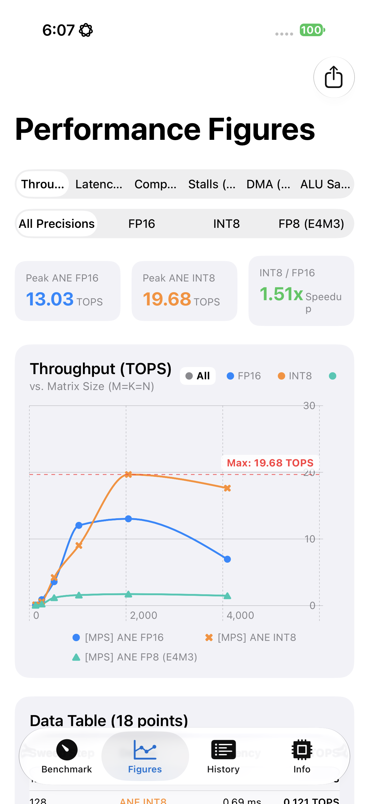
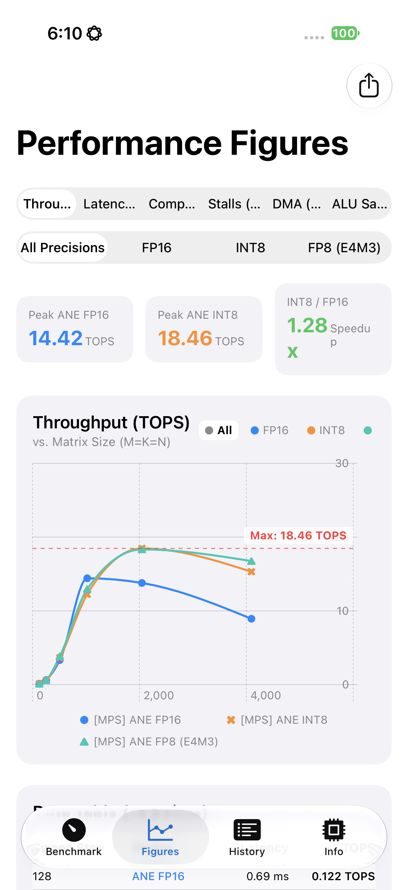
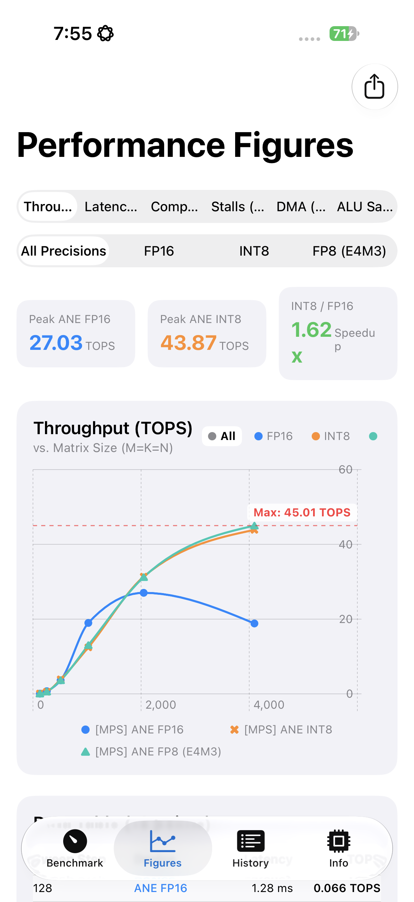

# ANE Peak TOPS Across H17 / H18 / H19 — FP8's Generation Lock Is One Chip Earlier Than the GPU's

Companion to `docs/GPU_Peak_TOPS_A18_A19_A20_Report.md`. Same three devices,
same app, same sweep (`--ane --mps --all --sweep matmulDimensions`, 128³–4096³,
L=20, `--autorun`), same day — but target `.ane` instead of `.gpu`. The ANE
engine doesn't expose a raw matmul primitive; `ANECapacityEngine.runSingle`
maps GEMM onto ANE as a 1×1 convolution (`[B,K,H,W]×[N,K,1,1]→[B,N,H,W]`,
documented at the top of that branch in `ANECapacityEngine.swift`) and lets
MPSGraph's ANE compilation path (`preferredDevice = 2`) decide per-precision
whether it can actually compile to the Neural Engine.

| Device | Chip | ANE generation |
|---|---|---|
| iPhone 16 Pro | A18 Pro | H17 |
| iPhone 17 Pro | A19 Pro | H18 |
| iPhone 18 Pro | A20 Pro | H19 |

(ANE generation number = A-series number minus 1 — an existing, already-documented
mapping in this repo, not something this report establishes.)

## The headline difference from the GPU story

The GPU's FP8 hardware cutoff is A20 Pro only (`Apple11` GPU family — see the
companion report). **The ANE's FP8 cutoff is one generation earlier**: H18 and
H19 (iPhone 17 Pro **and** iPhone 18 Pro) both compile FP8 natively to the
Neural Engine. Only iPhone 16 Pro (H17) can't — and unlike the GPU's hard
crash, the ANE failure is silent and non-fatal: MPSGraph just declines to
emit an ANE microcode bundle and the op runs on GPU instead, with no error,
exception, or crash of any kind. The tell is purely in the console log:

```
[MPS]    [PMU] Locating compiled ANE microcode bundle...
[MPS]    [PMU Note] No temporary ANE bundle emitted by MPSGraph on this runtime/device.
```

vs. the success case:

```
[MPS]    [PMU] Locating compiled ANE microcode bundle...
[MPS]    [PMU] Found ANE microcode bundle: mpsgraph-<pid>-<timestamp>-<hash>
[MPS]    └─ PMU: Compute=+..., Stalls=+..., DMA=+... MB, ALU Saturation=...%, Clock=... GHz
```

On iPhone 16 Pro, every one of the 6 FP8 sweep steps printed the "No temporary
ANE bundle" line; on iPhone 17 Pro and iPhone 18 Pro, every FP8 (and FP16, and
INT8) step printed a real PMU bundle with real compute/stall/DMA counters. The
measured numbers below bear this out directly: iPhone 16 Pro's "ANE FP8"
throughput is numerically indistinguishable from its GPU FP8 fallback numbers
in the companion report (e.g. 1.73 TOPS at 4096³, 1.58 TOPS at 1024³ — same
figures, because it's literally the same GPU path underneath).

## Peak ANE TOPS, Matrix Dimension Sweep (128³–4096³, L=20, all three precisions in one run)

**iPhone 16 Pro (H17):**

| Size | FP16 | INT8 | FP8-E4M3 |
|---|---|---|---|
| 128³ | 0.08 | 0.12 | 0.05 |
| 256³ | 0.89 | 0.58 | 0.24 |
| 512³ | 3.59 | 4.22 | 1.19 |
| 1024³ | 12.04 | 9.02 | 1.58 |
| 2048³ | **13.03** | **19.68** | **1.73** |
| 4096³ | 6.96 | 17.62 | 1.48 |



*FP8 (teal) is pinned far below FP16 and INT8 across the whole sweep — the visual signature of "silently running on GPU, not ANE."*

**iPhone 17 Pro (H18):**

| Size | FP16 | INT8 | FP8-E4M3 |
|---|---|---|---|
| 128³ | 0.12 | 0.11 | 0.12 |
| 256³ | 0.63 | 0.55 | 0.60 |
| 512³ | 3.33 | 3.64 | 3.86 |
| 1024³ | **14.42** | 12.24 | 12.95 |
| 2048³ | 13.78 | **18.46** | 18.33 |
| 4096³ | 8.93 | 15.30 | 16.75 |



*FP8 now tracks INT8 almost exactly, both clearly above FP16 — real native ANE hardware acceleration, one generation earlier than the GPU gets it.*

**iPhone 18 Pro (H19):**

| Size | FP16 | INT8 | FP8-E4M3 |
|---|---|---|---|
| 128³ | 0.07 | 0.09 | 0.08 |
| 256³ | 0.72 | 0.56 | 0.62 |
| 512³ | 3.63 | 3.89 | 3.65 |
| 1024³ | 18.97 | 12.43 | 13.04 |
| 2048³ | **27.03** | 31.36 | 31.23 |
| 4096³ | 18.84 | **43.87** | **45.01** |



*Same shape as H18, scaled up — FP8/INT8 keep climbing through 4096³ where H17/H18 start to roll off (see below).*

## Peak-TOPS summary and the INT8/FP16 ratio the app computes in-line

| Device | Peak FP16 | Peak INT8 | INT8/FP16 (app's own "Speedup" card) | Peak FP8 |
|---|---|---|---|---|
| iPhone 16 Pro (H17) | 13.03 TOPS | 19.68 TOPS | 1.51x | 1.73 TOPS (not real — GPU fallback) |
| iPhone 17 Pro (H18) | 14.42 TOPS | 18.46 TOPS | 1.28x | 18.33 TOPS (real) |
| iPhone 18 Pro (H19) | 27.03 TOPS | 43.87 TOPS | 1.62x | 45.01 TOPS (real) |

Two separate stories here, not one:

1. **INT8 vs FP16 is a smooth, every-generation win** (1.28x–1.62x), present
   on all three chips — unsurprising, since ANE INT8 has existed since H13.
2. **FP8 is a step function**, exactly where the generation table says it
   should be: worthless (literally a GPU number in ANE's clothing) on H17,
   then immediately competitive with INT8 — not a fraction of it — on both
   H18 and H19.

## A second, unrelated pattern worth flagging: FP16 rolls off at 4096³, low-precision doesn't (as much)

All three devices show **FP16 throughput peaking at 1024³–2048³ and then
dropping** at 4096³ (16 Pro: 13.03→6.96 TOPS, roughly halving; 17 Pro:
14.42→8.93 TOPS; 18 Pro: 27.03→18.84 TOPS). INT8 and FP8 show the same
roll-off on H17/H18 (e.g. 17 Pro INT8 18.46→15.30, FP8 18.33→16.75) but **not**
on H19, where both keep climbing all the way to 4096³ (31.36→43.87,
31.23→45.01). This reads like an ANE on-chip SRAM/working-set capacity
difference between generations — larger GEMMs' activations/weights spill out
of whatever's resident on H17/H18 earlier than on H19 — but this report
doesn't trace that further; it's a flagged-but-unexplained observation, not a
finding. (The companion GPU report's L2 SRAM framing in `matmulAsymmetric`'s
sweep design is the closest existing investigation of this general class of
effect, just not for ANE specifically.)

## Gaps

- The FP16-rolloff-at-4096³ pattern above is observed, not explained — no PMU
  SRAM-residency counter was checked to confirm the working-set-spill
  hypothesis.
- This report only covers the GEMM-as-1×1-conv path (`matmulDimensions`
  sweep). The companion GPU report also smoke-tested `matmulDepth`/
  `matmulAsymmetric` on GPU; those weren't re-verified here for ANE target.
- Existing ANE conv (3×3, not 1×1-mapped-GEMM) peak-TOPS numbers already
  documented elsewhere in this repo (`ANE_H19_Theoretical_Peak_and_Winograd_FP8_Analysis.md`,
  `FP8_BENCHMARKING_AND_ANE_ARCHITECTURE.md`) were not re-run — they use a
  different workload shape (3×3 convolution, not GEMM) and already have
  iPhone 17 Pro and iPhone 18 Pro data; only iPhone 16 Pro was the genuinely
  missing data point there, and this report's GEMM numbers (not conv numbers)
  fill a different gap, not that one.
