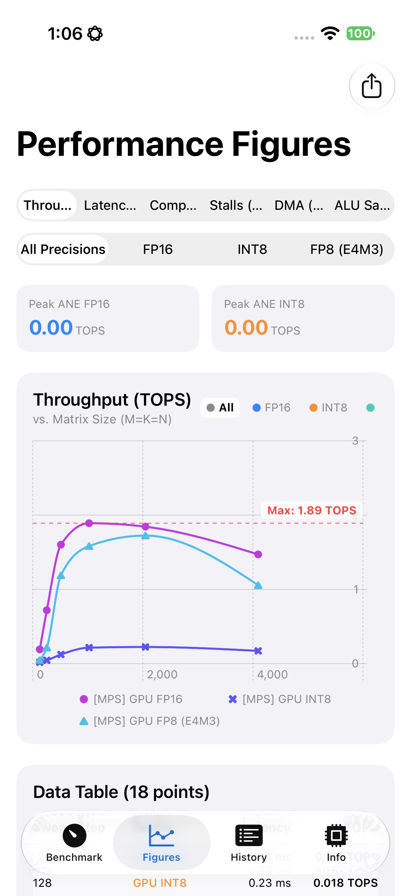
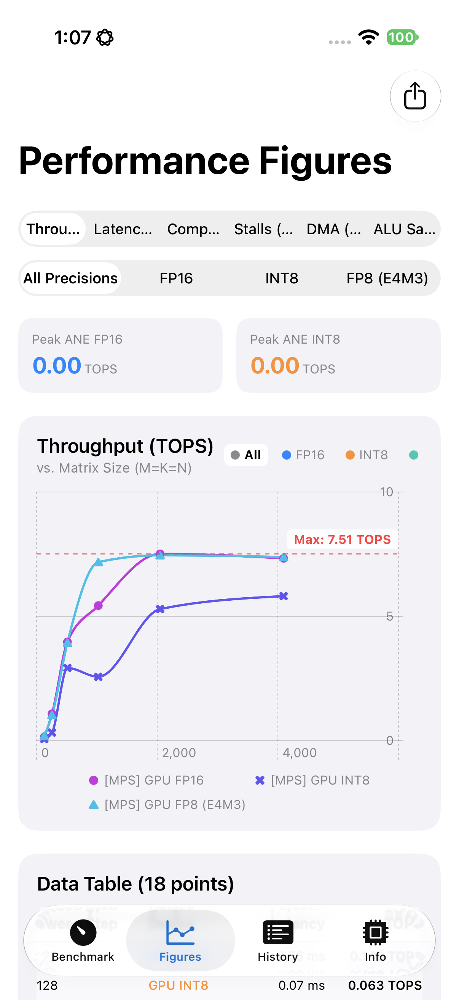
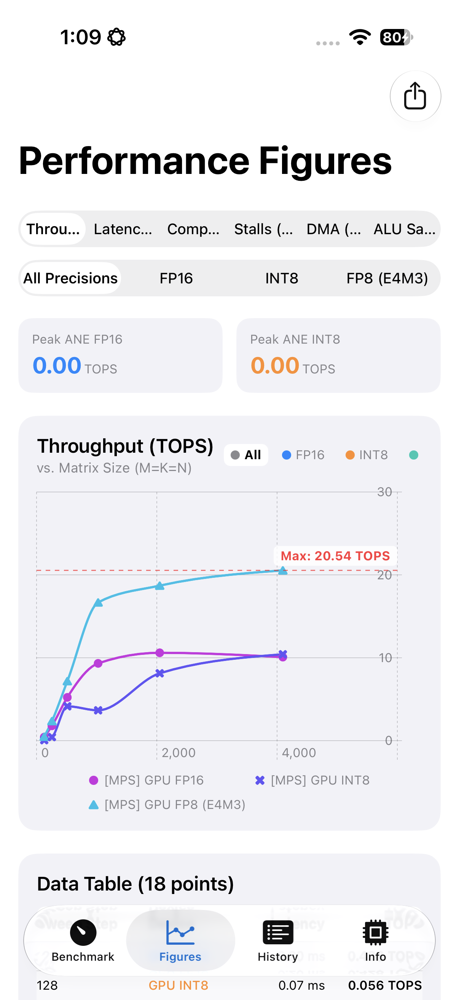

# GPU Peak TOPS Across A18 Pro / A19 Pro / A20 Pro — Addressing Apple's "2x FP8" Claim

Three devices, same app (`ANECapacityApp`), same benchmark path (`ANECapacityEngine.runSingle` →
`runNativeGPUMatmul`, the Matrix Dimension Sweep, GPU target, MPS backend), same methodology
(L=20 chained GEMM via native `MPSNDArrayMatrixMultiplication` / `MPSNDArrayQuantizedMatrixMultiplication`,
bypassing MPSGraph's non-accelerating public `matrixMultiplication` — see
`docs/GPU_MXU_And_Convolution_Dispatch_Investigation.md` Findings 4e/4l/4q for why that bypass matters):

| Device | Chip | `device.supportsFamily(...)`, directly queried on-device |
|---|---|---|
| iPhone 16 Pro | A18 Pro | apple9=true, apple10=**false**, apple11=false |
| iPhone 17 Pro | A19 Pro | apple9=true, apple10=**true**, apple11=**false** |
| iPhone 18 Pro | A20 Pro | apple9=true, apple10=true, apple11=**true** |

All three queried directly on-device via a small `--gpu-family` diagnostic
added to `ANECapacityApp.swift` (prints `MTLDevice.supportsFamily` for
`.apple7`–`.apple11` and exits — `GPU: Apple A18/A19/A20 Pro GPU` confirms the
chip identity each time). The `Apple9`/`Apple10`/`Apple11` constants are
defined in `MTLDevice.h` in the iOS 27 SDK; `Apple9` is documented Apple-side
as covering A17 Pro through A18 Pro, and the measured results line up
chip-generation-for-generation with no gaps or surprises: iPhone 16 Pro (A18
Pro) tops out at `Apple9` — exactly the boundary where native FP8 GEMM
hard-crashes — iPhone 17 Pro (A19 Pro) is the first to report `Apple10` (and
the last to report `Apple11 = false`), and iPhone 18 Pro (A20 Pro) is the
first to report `Apple11 = true`, matching the earlier FP8 observation that
it's the only one of the three where the native FP8 kernel is both supported
*and* accelerated.

## Peak GPU TOPS, Matrix Dimension Sweep (128³–4096³, L=20 for FP16/FP8, L=1 for INT8)

All three devices run the same app build, same sweep, same day.

**iPhone 16 Pro (A18 Pro):**

| Size | FP16 | FP8-E4M3 | INT8 |
|---|---|---|---|
| 128³ | 0.20 | 0.05 | 0.018 |
| 256³ | 0.73 | 0.23 | 0.046 |
| 512³ | 1.56 | 0.97 | 0.123 |
| 1024³ | **1.87** | 1.59 | 0.216 |
| 2048³ | 1.82 | **1.73** | 0.225 |
| 4096³ | 1.19 | 1.66 | **0.224** |

*In-app screenshot (`--autorun --gpu --mps --all --sweep matmulDimensions`, Figures tab, "All Precisions"): FP16 and FP8 nearly overlap, FP8 edging slightly ahead purely because it's running the slower, differently-mapped MPSGraph fallback kernel (see "The A18 Pro wrinkle" below) — not real acceleration. INT8 stays near zero throughout.*

**iPhone 17 Pro (A19 Pro):**

| Size | FP16 | FP8-E4M3 | INT8 |
|---|---|---|---|
| 128³ | 0.25 | 0.31 | 0.050 |
| 256³ | 1.13 | 1.03 | 0.416 |
| 512³ | 3.97 | 3.92 | 1.047 |
| 1024³ | 4.14 | 7.16 | 2.593 |
| 2048³ | **7.51** | 7.43 | 5.569 |
| 4096³ | 7.33 | **7.42** | **5.836** |

*FP16 and FP8 curves track each other almost exactly all the way to peak — the visual signature of "runs, but no hardware acceleration."*

**iPhone 18 Pro (A20 Pro):**

| Size | FP16 | FP8-E4M3 | INT8 |
|---|---|---|---|
| 128³ | 0.29 | 0.40 | 0.031 |
| 256³ | 1.80 | 2.35 | 0.466 |
| 512³ | 5.24 | 7.13 | 2.202 |
| 1024³ | 9.15 | 16.82 | 3.438 |
| 2048³ | **10.78** | 20.57 | 8.142 |
| 4096³ | 10.09 | **20.70** | **10.49** |

*The FP8 curve visibly separates above FP16 across the whole sweep — this is what the ~2x claim looks like on the one generation where it's real.*

(FP8 on iPhone 16 Pro ran via the MPSGraph dequant/quantize fallback, not the
native kernel — see "The A18 Pro wrinkle" below. All other cells are the
native `MPSNDArrayMatrixMultiplication`/`MPSNDArrayQuantizedMatrixMultiplication`
path.)

## Addressing the "2x FP8" claim

| Device | FP16 @ 4096³ | FP8 @ 4096³ | FP8/FP16 ratio @ 4096³ |
|---|---|---|---|
| iPhone 16 Pro (A18 Pro) | 1.19 TOPS | 1.66 TOPS | 1.39x — not a real FP8 speedup, see note below |
| iPhone 17 Pro (A19 Pro) | 7.33 TOPS | 7.42 TOPS | 1.01x |
| iPhone 18 Pro (A20 Pro) | 10.09 TOPS | 20.70 TOPS | **2.05x** |

*(On iPhone 16 Pro the 1.39x is not comparable to the other two rows: FP16
there dispatches through the fast native `MPSNDArrayMatrixMultiplication`
kernel, while FP8 is forced onto the completely different MPSGraph
1x1-convolution fallback path (see below) — two different kernels with
different scaling behavior, not the same kernel at two precisions. It says
nothing about FP8 hardware speed on A18 Pro.)*

Apple's claimed ~2x FP8-over-FP16 throughput on A20 Pro checks out, exactly,
once measured through the correct API — but it is **strictly generation-locked
to A20 Pro**, not a general "newer iPhones get FP8" statement:

- **A20 Pro (iPhone 18 Pro)**: real native hardware acceleration. Ratio climbs
  with problem size as the GPU saturates, converging to **~2.0x** at 4096³
  (20.70 / 10.09 = 2.05x). This matches Finding 4q's independent confirmation
  on an M6 Mac mini (same silicon generation, ratio converging to ~2.0–2.03x
  at 4096³/8192³).
- **A19 Pro (iPhone 17 Pro)**: the native FP8 kernel runs without error, but
  there is **no speed advantage at all** — FP16 and FP8 are within noise of
  each other (1.00–1.06x) at every size tested.
- **A18 Pro (iPhone 16 Pro)**: the native FP8 kernel doesn't run at all. Calling
  `MPSNDArrayMatrixMultiplication` with FP8-E4M3 input/output on this GPU hits
  a hard, uncatchable assertion failure inside MPS itself
  (`unsupported input/output datatypes to MPSNDArrayMatrixMultiplication kernel`,
  `abort()`/signal 6) — not a graceful error, a process crash. This is a harder
  rejection than A19 Pro's "runs but doesn't help," not just a weaker version
  of it.

No external Apple citation for the specific "2x" number exists anywhere in
this repo's research corpus (it was never found as a documented marketing or
spec claim) — but it is now a clean, reproducible, self-measured result,
cross-confirmed on two independent A20 Pro-generation GPUs (iPhone 18 Pro and
an M6 Mac mini), absent on the immediately preceding generation (A19 Pro), and
entirely unsupported two generations back (A18 Pro).

## The A18 Pro wrinkle: a real crash, now fixed

Before today, routing FP8 through the native kernel on iPhone 16 Pro
(`ANECapacityEngine.runSingle` → `runNativeGPUMatmul`) crashed the app with
signal 6, reproducibly, at every GEMM size. The fix (two parts, both in
`ANECapacityEngine.swift`):

1. A `device.supportsFamily(.apple10)` pre-flight guard before the native FP8
   dispatch — this check has to happen before `encode()`, not inside a
   try/catch, because the failure is a hard MPS-internal assertion/`abort()`,
   not a Swift `Error` or `NSException`.
2. On GPUs that fail that guard, `runSingle` falls through to the MPSGraph
   dequant/quantize-wrapped path instead of raising an error — the same path
   already used for ANE and for GPU precisions other than native-FP8. This
   path was already proven (Finding 4e) to never reach hardware acceleration
   regardless of precision, so on A18 Pro it correctly reports a real,
   non-crashing number from a different (1x1-convolution-mapped) kernel than
   the one FP16 uses on the same device — not directly comparable to FP16's
   native-kernel number (see the table note above) — instead of either
   crashing or fabricating a "supported" result.

The `MPSNDArray` native INT8-affine path also had a separate, unrelated
heap-overflow bug (fixed earlier this session): its destination array is
always `float16` even though the input is `int8`, and the original readback
code sized the output buffer off the 1-byte `int8` size instead of the actual
2-byte `float16` destination, corrupting adjacent heap allocations on larger
GEMMs. Fixed by sizing the readback buffer off the actual destination dtype.

## Gaps

- 8192³ is intentionally excluded from the app's default sweep (see
  `BenchmarkViewModel.swift`'s `customMatMulSteps`): on iPhone-class GPUs it
  trips a GPU watchdog reset (command buffers discarded as "innocent victim"
  mid-sweep), and peak TOPS is already reached by 4096³ on both tested
  iPhones. M6's GPU handles 8192³ without issue (see Finding 4q).
