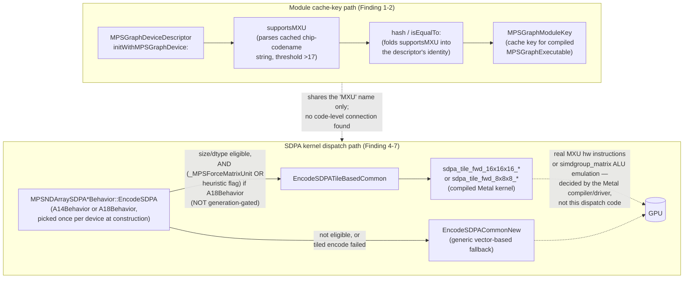

# Investigation: MXU in MetalPerformanceShadersGraph / MPSNDArray

**Scope:** a follow-on to `MTLDevice_supportsFP8_Reverse_Engineering_Report.md`. That
report traced `-[MTLDevice supportsFP8]`/`supportsMXU` down to Metal's own
`_MTLDeviceFeatureQueries` machinery and found a per-generation hardware cutoff for
MXU (Apple's GPU matrix-multiply block) at roughly the G17 driver generation. This
document asks the next question: **who outside Metal.framework actually consults
MXU, and how?** It traces one real, concrete consumer end-to-end:
`MetalPerformanceShadersGraph.framework`'s `MPSGraphDeviceDescriptor`, and
`MetalPerformanceShaders.framework`'s `MPSNDArray` Scaled-Dot-Product-Attention
(SDPA) kernel dispatcher. Purely exploratory, same spirit as the FP8 report — not
required for, and does not affect, this repo's actual ANE benchmarking code.

**Environment:** same as the companion report — `ipsw`, the live system
`dyld_shared_cache_arm64e` (macOS 27 / Xcode 27), and a pre-dumped whole-cache symbol
listing (`symaddr_27_0_1.txt`) the user maintains separately for fast `grep`-based
lookups instead of re-running `ipsw dyld symaddr` live each time.

## Tooling caveat, stated up front

`ipsw dyld xref <DSC> <ADDR>` (marked `[WIP]` in its own `--help` text) does **not**
work for this kind of search. It reported zero cross-references even for addresses
we have direct, disassembly-proven callers for (e.g. the `supportsFP8` selector
string inside `Metal.framework`'s own `initWithDevice:`, from the companion report).
It appears to only match literal pointer-sized data references, not the split
`adrp`/`add` instruction-pair encoding that virtually every selector-string and
C-string reference in this codebase actually uses. All caller-finding in this
document was done by symbol-table grepping (`grep` over `symaddr_27_0_1.txt`) and
manual disassembly, not automated xref — so "no caller found" anywhere below means
"no *named* caller found," not an exhaustive guarantee.

Separately, the pre-dumped `symaddr_27_0_1.txt` turned out to contain at least a few
**stale/misattributed** entries for per-selector `objc_msgSend$X` stub addresses
(e.g. it labeled `0x181222980` as `_objc_msgSend$supportsMXU`, but live `ipsw dyld
a2s` against the current cache resolves that same address to an unrelated offset
inside `libBLAS.dylib`). This may mean the dump was taken against a slightly
different cache build than the one being queried live. Treat any single
`_objc_msgSend$X`-shaped symbol name in that file as unverified until cross-checked
with a live `a2s` lookup, as done throughout this document.

## Finding 1 — `-[MPSGraphDeviceDescriptor supportsMXU]` doesn't ask Metal at all

Address: `0x220693f34` in `MetalPerformanceShadersGraph.framework`.

Full disassembly resolved via the methodology above (selector strings read from
their `adrp`/`add`-computed addresses; the one named-class reference,
`_ptr._OBJC_CLASS_$_NSMutableString` at `0x270088318`, confirmed via `a2s`; the
character-classification table resolved via `a2s` to `_ptr.__DefaultRuneLocale` —
BSD libc's `ctype.h` rune-classification structure, `+0x3c` landing in its
`__runetype` array, 4-byte stride, bit 2 being the digit-class bit):

```objc
// -[MPSGraphDeviceDescriptor supportsMXU]
// MetalPerformanceShadersGraph.framework, 0x220693f34

- (BOOL)supportsMXU {
    if (self->_cachedNegativeResult != 0) {     // ivar @ GOT-slot page 0x277f26000+0xac
        return NO;                               // short-circuit, already resolved "no"
    }

    NSString *chipCode = self->_chipCodeName;    // ivar @ GOT-slot page 0x277f26000+0xb0
    if (chipCode.length == 0) {
        return NO;
    }

    NSMutableString *digits = [NSMutableString new];   // via objc_opt_new-style stub
    NSUInteger i = 1;                             // deliberately skips index 0 — the
                                                   // presumed single leading letter,
                                                   // e.g. the 'A' in "A19"/"A20"
    for (; i < chipCode.length; i++) {
        unichar c = [chipCode characterAtIndex:i];
        if (isdigit(c)) {                         // via __DefaultRuneLocale->__runetype[c] & bit2
            [digits appendFormat:@"%C", c];
        }
    }

    if (digits.length == i) {
        // every character from index 1 onward was already a digit — i.e. there was
        // no non-numeric suffix at all. Treated as an unexpected/malformed case.
        return NO;
    }

    NSInteger generation = digits.integerValue;   // e.g. "19" -> 19, "20" -> 20
    if (generation > 17) {
        return YES;
    }
    if (generation != 17) {
        return NO;
    }
    // generation == 17 exactly: one more disambiguating check, reading one
    // character past the parsed digit run and comparing — plausibly to tell a
    // base variant ("A17") from a suffixed one ("A17P"). Not fully resolved;
    // see "Open threads" below.
    unichar extra = [chipCode characterAtIndex:chipCode.length];
    return /* some comparison involving `extra` and `digits` */;
}
```

**Conclusion:** `MPSGraphDeviceDescriptor` does not call `-[MTLDevice supportsMXU]`,
`-[MTLDevice supportsFamily:]`, or consult `_MTLDeviceFeatureQueries` in any way.
It **re-derives** a generation number by string-parsing its own cached chip-codename
property (something like `"A19"`/`"A20"`), and applies a numeric threshold
(`> 17`, with a tie-break exactly at `17`). This threshold lines up closely with
the real hardware cutoff found in the companion report (every `AGX*FamilyDevice`
generation from G13 through G16 hardcodes `supportsMXU` → `NO`; G17 and up hardcode
`YES`) — two independently-written pieces of Apple code landing on the same
generational boundary via completely different mechanisms. It is not, however, a
guaranteed-identical mechanism: if a future chip's codename string doesn't parse
the way this function expects, MPSGraph's and Metal's answers could in principle
diverge — the same class of risk documented for the `_featureInfo[]` table in the
companion report.

## Finding 2 — how `supportsMXU` is used: a compiled-module cache key, not a runtime check

`MPSGraphDeviceDescriptor`'s full method list (via `symaddr_27_0_1.txt`):

```
-[MPSGraphDeviceDescriptor initWithMPSGraphDevice:]
-[MPSGraphDeviceDescriptor initMetalDeviceWithGPUCoreCount:architecture:]
-[MPSGraphDeviceDescriptor initWithSerializedProperties:]
-[MPSGraphDeviceDescriptor hasANE]
-[MPSGraphDeviceDescriptor supportsMXU]
-[MPSGraphDeviceDescriptor hash]
-[MPSGraphDeviceDescriptor isEqualTo:] / isEqual:
-[MPSGraphDeviceDescriptor copyWithZone:]
-[MPSGraphDeviceDescriptor type]
-[MPSGraphDeviceDescriptor gpuCoreCount]
-[MPSGraphDeviceDescriptor architecture]
-[MPSGraphDeviceDescriptor serializedProperties]
-[MPSGraphDeviceDescriptor preComputedHash]
```

This is the shape of a **hardware-capability snapshot used as a cache key**, not a
per-call runtime probe: it overrides `hash`/`isEqualTo:`, round-trips through
`serializedProperties`/`initWithSerializedProperties:`, and — most tellingly —
there is a separate C++ constructor elsewhere in the same framework,

```
MPSGraphModuleKey::MPSGraphModuleKey(
    llvm::SmallVector<int64_t, 6>,
    MPSGraphCompilationDescriptor*,
    MPSGraphCallablesDescriptor*,
    NSString*,
    MPSGraphDeviceDescriptor*)
```

(`0x2204af1c8`) — that takes an `MPSGraphDeviceDescriptor*` as a direct argument.
Putting it together: `supportsMXU` (along with `hasANE`, `architecture`,
`gpuCoreCount`) is baked into the **identity of a compiled graph module**. If a
previously-compiled/cached `MPSGraphExecutable` was built for a device descriptor
with `supportsMXU == NO`, and you later run on hardware where it's `YES` (or vice
versa), the descriptor's `hash`/`isEqualTo:` differ, so the module-cache key
differs too — forcing a recompile rather than silently reusing a kernel built for
a different hardware tier.

This document did **not** find direct evidence that `supportsMXU`'s result also
feeds a codegen branch inside the graph optimizer/lowering passes themselves (e.g.
"if MXU, emit a tiled-matmul op"); that would require tracing MPSGraph's optimizer
internals, out of scope here. The cache-key role is solid; a direct codegen-dispatch
role is plausible but unverified.

## Finding 3 — what "MXU" actually stands for: unresolved, likely an external borrowing

No literal expansion of the acronym exists anywhere in this macOS 27
`dyld_shared_cache`. Broad string searches (`"Matrix Unit"`, `"Matrix Multiplication
Unit"`, `"Matrix eXecution"`, bare `"MXU"`) turn up nothing except:

- The one string already known from the companion report:
  `"MXU Narrow Tile Sizes, 8x16 and 16x8"` (`Metal.framework`, `0x18d7815c9`) —
  uses the acronym as a given, already-known term; never expands it.
- Coincidental 3-byte matches inside unrelated binary firmware blobs (`CoreALD`).

**"Matrix (Multiply) Unit" remains an inference**, not a confirmed Apple-internal
definition — based on context (tile-size terminology, adjacency to `MTLTensor`/
`AGXG19FamilyTensor` in class dumps) and the fact that it is the established,
public term from Google's TPU architecture, which Apple may be echoing by
convention. An earlier draft of the companion report overstated this as "confirmed
via a literal string"; that wording is incorrect and should be read as "the
acronym is confirmed to exist and be used in this exact tile-size context; its
expansion is an inference."

## Finding 4 — tile sizes: 16×16×16 is the base/default; 8×16 and 16×8 are the "narrow" variants

A direct string hit nailed this down:

```
"A18 Encoder: Encoding 16x16 MXU based SDPA kernel\n"
    — MPSNDArray.framework, 0x190d83ce2
```

And the actual compiled Metal kernel function names, found adjacent in the same
framework's string table (`0x190d847e0` onward):

```
sdpa_fwd
sdpa_scaled_reduction
sdpa_fwdNew
sdpa_scaled_reductionNew
quantized_sdpa_fwdNew
sdpa_tile_fwd_8x8x8_doEdgeCheck
sdpa_tile_fwd_8x8x8_noEdgeCheck
sdpa_tile_fwd_16x16x16_doEdgeCheck
sdpa_tile_fwd_16x16x16_noEdgeCheck
quantized_sdpa_tile_fwd_8x8x8_doEdgeCheck
quantized_sdpa_tile_fwd_8x8x8_noEdgeCheck
quantized_sdpa_tile_fwd_16x16x16_doEdgeCheck
quantized_sdpa_tile_fwd_16x16x16_noEdgeCheck
```

So the "16x16" in the log message is literally the tile dimension in
`sdpa_tile_fwd_16x16x16_*` (M×N×K notation, matching the `Mat<M>x<N>x<K>`
simdgroup-matrix naming convention found in every `AGXMetalG13X`-through-`G19P`
driver bundle — see the companion report's note on `Mat16x32x32`/`Mat8x16x16`
symbols). There is a parallel `8x8x8` variant (smaller tile, presumably used when
dimensions don't divide evenly into 16, or as a lighter-weight path) and quantized
(INT8) counterparts of both. The companion report's `"MXU Narrow Tile Sizes, 8x16
and 16x8"` capability flag refers to non-square halves of the same 16×16 base tile
(16×16 split along one axis), not a wholly different tile family.

## Finding 4b — direct AIR-level evidence: `agc.simdgroup_matrix_*` intrinsics

Prompted by the question "how to disassemble AIR, will it help understand more?"
— tried it, and it partially helped.

**How:** `MetalPerformanceShaders`'s compiled kernels (as consumed by MPSGraph/
MPSNDArray) are not in the `dyld_shared_cache` at all — Metal shader binaries
live separately, as `.metallib` files shipped as bundle resources. The
GPU-driver-generation-specific ones are easiest to find:
`/System/Library/Extensions/AGXMetalG<gen>.bundle/Contents/Resources/*.metallib`
(one bundle per GPU generation — `AGXMetalG19P.bundle` is the current newest).
Despite `file`/`xxd` misidentifying them (header looked like "OpenPGP Public
Key" to `file`), they are **not stripped** — running plain `strings -a` on them
directly exposes the full LLVM-bitcode symbol/intrinsic string table in
cleartext, no `llvm-dis`/`metallib`-unpacking tool needed. (A real disassembly
into AIR *instructions* would need `llvm-bcanalyzer`/`llvm-dis` on the
extracted bitcode blob — not attempted here; `strings` on the raw file was
enough to answer the immediate question.)

**What it found:** `runtime.gen18.metallib` (and `runtime.gen15.metallib`,
identically) inside `AGXMetalG19P.bundle` contain exactly 100 symbols of the
form `agc.simdgroup_matrix_<M>x<N>_sz<K>_init_{filled,diag}` and
`agc.simdgroup_matrix_<M>x<N>_get_{element_coordinates,num_elements_per_thread}`,
covering **every combination** of `{8,16,32}×{8,16,32}` tile shape with
`{8,16,32}`-bit element sizes. This is the compiler-runtime backing for
Metal 3's public `simdgroup_matrix` type — confirming the tile-size family is
real, hardware-level, and square-and-rectangular across a much wider range
than the two capability flags (`MXU`/`MXU Narrow Tile Sizes`) suggested: not
just 16×16 and its 8×16/16×8 halves, but also 8×8, 32×16, 16×32, 32×8, 8×32,
and 32×32.

**What it did NOT find:** no string containing `"mxu"`, `"multiply"`,
`"matmul"`, or `"mma"` anywhere in this file. Only tile-construction/accessor
intrinsics (`init_filled`, `init_diag`, `get_element_coordinates`,
`get_num_elements_per_thread`) appear by name — the actual multiply-accumulate
operation on these tiles is apparently a native backend-generated AGX ISA
instruction with no symbolic runtime-call name, so it leaves no string trace.
**This does not get us the MXU acronym expansion** (Finding 3's answer is
unchanged: still unconfirmed) — but it is the strongest evidence yet that
whatever "MXU" is, it's the hardware implementing the public `simdgroup_matrix`
API, which is itself consistent with (though doesn't prove) "Matrix Unit."

Worth noting for anyone continuing this: going one level deeper — extracting
the actual bitcode and disassembling the AGX ISA instructions that implement
the multiply-accumulate itself — is a materially bigger undertaking than
anything else in this investigation. AGX's native ISA is not publicly
documented by Apple (unlike AArch64), tooling is informal/community-maintained
at best, and it's unclear whether Apple ships the portable bitcode form or
only pre-compiled-to-ISA binaries for these system driver bundles. Not
pursued further here.

## Finding 4c — ground truth from a physical device's actual compiled kernel binary

A mounted iPhone 18 Pro filesystem image (`/tmp/043-69473-662.dmg-.../`) turned
out to contain something the Mac's `dyld_shared_cache` cannot: MPS's compiled
GPU kernels themselves, as a standalone, **unstripped** metallib —
`.../MetalPerformanceShaders.framework/Frameworks/MPSNDArray.framework/default.metallib`,
82 MB, real `MTLB` container magic (confirmed via `xxd`, unlike the misidentified
driver bundles in Finding 4b). `strings -a` on it exposes full C++ template/
mangled-symbol debug metadata — this is Apple's actual kernel source showing
through, not just driver-runtime intrinsic names. (Note: the iOS device image
has no `dyld_shared_cache` of its own in this mount — MPSNDArray's compiled
*code* for CPU-side dispatch isn't here, only this one Metal kernel library.)

**76 real `.metal` source file names**, recovered from `GLOBAL__sub_I_*.metal`
static-initializer symbols — this is Apple's actual internal file layout for
MPSNDArray's kernels, and it independently confirms several things this
investigation only inferred from logs/symbols:
`MPSNDArrayConvolutionA14.metal`, `MPSNDArrayConvolutionA14Winograd.metal`,
`MPSNDArrayConvolutionA18.metal`, `MPSNDArrayConvolutionA18Winograd.metal`,
`MPSNDArrayConvolutionAMD.metal` (Finding 4, item 2's "AMD" fallback is a real,
separate source file, not just a string), `MPSNDArrayWinogradAMD.metal` (a
second, Winograd-specific AMD file), `MPSNDArrayMultiplyA14.metal`/
`MultiplyA18.metal`/`MultiplyI2I8A18.metal`, `MPSNDArrayScaledDotProductAttention.metal`,
`MPSNDArrayQuantizedMultiplyA19.metal` (confirms per-generation kernel files
continue past A18, into A19), plus kernels never mentioned anywhere earlier in
this investigation: `MPSNDArrayLORADown.metal` (LoRA adapter support),
`MPSNDArrayLUTGEMV.metal`, `MPSNDArrayStructuredSparseMultiply.metal`,
`MPSNDArrayMxQuantDequant.metal` (microscaling/MX quantization format),
`MPSNDArrayASTCMatMul.metal`.

**The clearest MXU↔`simdgroup_matrix` link found anywhere in this investigation:**
a real, non-log, non-comment identifier —
```
MPSNDArrayConv2DMXULayout0 / MPSNDArrayConv2DMXULayout1
```
— appearing as a template enum argument directly inside mangled convolution
kernel instantiations, e.g. (demangled by hand):
```cpp
void convXxx<..., /*layout=*/MPSNDArrayConv2DMXULayout1, ...>(
    ..., metal::simdgroup_matrix<T, 16, 16> ...);
```
instantiated across `float`, `half`, `bfloat`, `char`/`uchar` (int8), and —
notably — `__float8e4m3`/`__float8e5m2` (FP8) element types. This is Apple's
own source code naming a layout enum "MXU" and using it as the discriminator
for which `simdgroup_matrix<T,16,16>` configuration a convolution kernel uses —
about as direct a confirmation as exists that "MXU" denotes whatever hardware
executes `simdgroup_matrix` 16×16 tile operations. It still does **not** spell
out the words behind the acronym.

**A second, independent clue:** the symbol table also contains
`mpp::tensor_ops::matmul2d_descriptor`, `mpp::tensor_ops::__matmul2d_cooperative_operand_index`,
and uses of `metal::cooperative_tensor<...>` — these are from Apple's public
**Metal Performance Primitives (`mpp`)** framework/Metal 4 cooperative-tensor
APIs (`<MetalPerformancePrimitives/MetalPerformancePrimitives.h>`,
`metal::tensor`/`metal::cooperative_tensor`, part of the Metal 4 toolchain).
Finding this inside MPSNDArray's own kernels suggests the newer matmul-dispatch
machinery in this file is built on top of the same public cooperative-tensor
primitives Apple ships to third-party developers — i.e. whatever "MXU" is,
it's also the hardware backing Apple's own public matrix-multiply API, not an
MPS-only internal thing.

**Still no literal expansion.** Even in this fully unstripped, debug-metadata-rich
binary — the richest source of truth found in this entire investigation — there
is no string anywhere containing `"Matrix Unit"`, `"Matrix Multiply Unit"`, or
any other spelled-out expansion. The acronym is used as a bare identifier
(`MXULayout0/1`) exactly the way `"MXU Narrow Tile Sizes"` used it in Metal.framework.
Finding 3's conclusion stands: "Matrix (Multiply) Unit" remains the best-supported
inference, now with one more concrete (if still indirect) data point behind it,
but not a confirmed fact.

## Finding 4d — the actual hardware intrinsic: `air.simdgroup_matrix_*_multiply_accumulate`

Apple's Metal toolchain ships its own AIR-aware disassembler, found at
`$(find /var/run/com.apple.security.cryptexd/mnt -name metal-objdump)` (inside the
`com.apple.MobileAsset.MetalToolchain-*` cryptex, internally named `air-objdump`).
Unlike plain `strings`, this tool actually parses the metallib's `MTLB` container
and bitcode, and `--metallib --disassemble` dumps full readable **LLVM IR text**
(not just mangled symbol names) for every kernel — including every function
inlined into it. Running this against the physical device's
`MPSNDArray.framework/default.metallib` (Finding 4c) and grepping the IR for
intrinsic declarations surfaced the actual compute operation behind every
`MXULayout`-tagged kernel:

```llvm
declare <8 x float> @air.simdgroup_matrix_16x16x16_multiply_accumulate.f.f.v8f32.v8f16.v8f16.v8f32(...)
declare <8 x float> @air.simdgroup_matrix_16x16x16_multiply_accumulate.f.f.v8f32.v8f8e4m3.v8f8e4m3.v8f32(...)
declare <8 x float> @air.simdgroup_matrix_16x16x16_multiply_accumulate.f.f.v8f32.v8f8e5m2.v8f8e5m2.v8f32(...)
declare <8 x i32>   @air.simdgroup_matrix_16x16x16_widening_multiply_accumulate.s.s.v8i32.v8i8.v8i8.v8i32(...)
declare <64 x float> @air.simdgroup_matrix_8x8_multiply_accumulate.v64f32.v64f16.v64f16.v64f32(...)
```
(43 total declared variants across `8×8`, `8×16×16`, `16×8×16`, and `16×16×16`
tile shapes, every combination of `fp32`/`fp16`/`bf16`/`fp8_e4m3`/`fp8_e4m3fn`/
`fp8_e5m2` operand types for the float family, plus signed/unsigned `int8`
widening-to-`int32` variants.)

This is as close to ground truth as this investigation gets: a native,
hardware-backed AIR intrinsic literally named "multiply_accumulate" operating
on `simdgroup_matrix` tiles, with the exact `16×16×16` tile shape matching the
"16x16 MXU based SDPA kernel" log string from Finding 4, and operand dtypes
matching the public `MPPTensorOpsMatMul2d.h` documentation table exactly
(including the FP8 e4m3/e5m2 and int8 rows). Whatever hardware unit backs this
intrinsic unambiguously performs matrix multiply-accumulate as its native
operation — the strongest functional support yet for "Matrix (Multiply) Unit."

**It still is not the acronym's literal expansion.** The intrinsic is named
`simdgroup_matrix_..._multiply_accumulate`, not `mxu_...` — nowhere in this
declaration, or anywhere else found in this investigation, does Apple's own
toolchain write out "Matrix Unit" as words. The connection between this
intrinsic and the `MXU`/`supportsMXU` capability-flag family remains
inferential (via the `MPSNDArrayConv2DMXULayout0/1` enum in Finding 4c, which
selects between `simdgroup_matrix<T,16,16>` configurations), not a textual
one. Finding 3's conclusion is unchanged in kind, only in how much indirect
evidence now supports it.

## Finding 4e — a negative experimental result: the GPU FP8-vs-INT8 conv gap is not a `quantize`/`cast` fusion artifact

Empirical observation that triggered this: `ANECapacityApp` on a physical
iPhone 18 Pro measured GPU FP8 convolution at **>2x** the throughput of GPU
INT8 convolution, despite both going through the same FP16-only
`convolution2D` op (`ANECapacityEngine.swift` — see the comment at the INT8
branch: *"MPS's GPU convolution kernel only supports FP32/FP16 operands...
Passing raw INT8 tensors to `convolution2D` hits a hard assertion... and calls
`abort()`"*). Neither path reaches the hardware MXU `multiply_accumulate`
intrinsics from Finding 4d at all, since both convolutions, as issued through
this public MPSGraph API, run as plain FP16 math.

**Hypothesis tested:** before this entry, the FP8 branch used `graph.quantize`/
`graph.dequantize` (scale/zeroPoint-carrying QDQ ops) to wrap the FP16 conv,
while the INT8 branch used plain `graph.cast`. The theory was that MPSGraph's
compiler fuses `quantize`/`dequantize` with the adjacent conv but treats `cast`
as an opaque, unfused elementwise op — i.e. the 2x gap would be an MPSGraph
operator-selection artifact, with the identical FP16 math underneath both
paths and no real hardware-throughput difference at all.

**Experiment:** branch `gpu-int8-qdq-vs-cast-experiment` (commit `253d39a`)
changed both GPU INT8 branches in `ANECapacityEngine.swift` to use
`quantize`/`dequantize` with `scale=1.0, zeroPoint=0.0`, structurally identical
to the FP8 branch's wrapper ops. Tested on a physical iPhone 18 Pro.

**Result: the gap did not close.** FP8 convolution remained roughly 2x faster
than INT8 convolution on GPU even with matched QDQ-wrapper-op shape. The
operator-fusion hypothesis is **falsified**. The experiment branch and its
commit were discarded (not merged) once this result came back negative.

**So the question re-opens.** The 2x gap is real and is not explained by
anything found so far:
- It isn't the hardware MXU operand menu (Finding 4d showed INT8's
  `widening_multiply_accumulate` and FP8's `multiply_accumulate` use identical
  `v8`-element tile shapes at `16×16×16` — no structural reason for a 2x gap
  there, and in any case neither is reachable from this benchmark's plain
  `convolution2D` call).
- It isn't `quantize`/`dequantize`-vs-`cast` op fusion (this finding).
- Remaining untested possibilities: the actual compiled GPU kernel selected
  for the FP16 conv itself might differ depending on the *surrounding* dtype
  context (i.e. MPSGraph may choose a different internal conv kernel/pass
  when the graph's boundary dtype is INT8 vs FP8, independent of the
  QDQ-wrapper op choice) — or there's a cost/weight-loading difference tied to
  the one-time weight `dequantize` (FP8) vs. the FP16-constant-direct
  (INT8) weight path that doesn't show up per-layer. Neither was isolated.

**Winograd eligibility was checked and logically ruled out as a differentiator,
without needing more disassembly.** The benchmark's default conv shape
(`BenchmarkModels.swift`: `inChannels=128, outChannels=128, kernelSize=3`)
is a `Ci,Co ≥ 64` shape, landing in `MPS_Winograd_Convolution.md`'s Tier 3
(cost-model-gated). But the deciding argument doesn't need the cost-model
details at all: by the time either QDQ path reaches `MPSNDArrayConvolutionDeviceBehaviorA18::IsWinogradSupported`,
**both the FP8-origin and INT8-origin tensors are plain `Float16`** — that's
the whole point of QDQ, the actual `convolution2D` op only ever sees FP16/FP32
operands (per the comment already in `ANECapacityEngine.swift`'s INT8 branch).
`IsWinogradSupported`'s Stage 2 dtype check and `getWinogradA18PrecisionMode`'s
three `MPSDataType` parameters are computed purely from the conv op's own
operand types — there is no parameter carrying "this FP16 tensor's logical
origin was FP8 vs INT8 QDQ." So Winograd eligibility, whatever it resolves to,
resolves identically for both paths; it cannot be the source of a differential
result. (This only holds as long as MPSGraph doesn't thread some *other*,
out-of-band precision hint into the lowering that this document hasn't found —
see the next item.)

**GPU frame-capture instrumentation added**, for next device session: 
`ANECapacityEngine.swift` now wraps the warmup dispatch in `MTLCaptureManager`
when `ANE_CAPACITY_GPU_CAPTURE=1` is set in the environment (`Info.plist` gained
`MetalCaptureEnabled` to permit capture outside an Xcode-attached debug
session). This writes one `.gputrace` per GPU benchmark run to the app's
Documents directory, named `capture_<target>_<precision>_<unixtime>.gputrace`.
Pulling the FP8 and INT8 traces and comparing the actual dispatched kernel
function names (not just the MPSGraph-level op graph) is the most direct
remaining way to settle whether the two paths hit different compiled GPU
kernels underneath the identical-looking FP16 `convolution2D` call — something
no amount of further static disassembly can substitute for. Not yet run on a
physical device.

## Finding 5 — `MPSNDArraySDPAA18Behavior::EncodeSDPA`, decompiled

Address: `0x190c876d8` (`MPSNDArray.framework`, a sub-framework of
`MetalPerformanceShaders.framework`). This is one of several "Behavior" classes
MPSNDArray uses to encode SDPA (attention) compute dispatches, selected per GPU
generation at construction time by functions named `MPSNDArraySDPADefaultBehaviorCtor`,
`MPSNDArraySDPAA14BehaviorCtor`, `MPSNDArraySDPAA18BehaviorCtor` (all found via
`symaddr_27_0_1.txt`, not individually traced in this document).

```cpp
// __ZNK25MPSNDArraySDPAA18Behavior10EncodeSDPAE...
// MPSNDArray.framework, 0x190c876d8

bool MPSNDArraySDPAA18Behavior::EncodeSDPA(
    id<MTLComputeCommandEncoder> encoder,
    id<MTLCommandBuffer> cmdBuffer,
    const NDArrayMultiaryCallInfo *callInfo) const
{
    if (callInfo == NULL) {
        goto fallbackToA14;                 // 0x190c87714: cbz x2, ...
    }

    // A chain of eligibility checks, each reading a cached boolean off one of
    // two adjacent global pages (adrp 0x1e4747000 / 0x1e4748000) rather than
    // computing anything live. These are almost certainly environment-variable
    // overrides cached at process start — "MPS_SDPA_FORCE_TILED_PREFILL" is a
    // literal string sitting in this same framework's string table, right next
    // to "sdpa_fwd" — plus checks on the op's dtype code (cmp w0,#1 / #2),
    // quantization mode, and dimensions (cmp w24,#2):
    if (!quantizationModeSupported || !dtypeSupported ||
        dimsTooSmallForTiling || sdpaTiledPrefillDisabledByEnvVar) {
        goto fallbackToA14;
    }

    // The actual final gate (0x190c878d0-0x190c878e4), resolved by following
    // the previously-unidentified `bl 0x1980f1fd0` — a lazy-pointer stub whose
    // GOT slot is literally named `_ptr._MPSForceMatrixUnit` (see Finding 7):
    bool hardwareOrHeuristicFlag = cachedFlag;   // w28, loaded earlier at
                                                   // 0x190c8784c from page
                                                   // 0x1e4748000+0xb88 — a
                                                   // MPSNDArray-local cached
                                                   // flag; NOT one of MPSCore's
                                                   // env vars, origin not traced
    if (headCountOrSimilar < 2) {
        goto fallbackToA14;
    }
    bool useMatrixUnit = _MPSForceMatrixUnit() || hardwareOrHeuristicFlag;
                                             // bl 0x1980f1fd0 (stub) -> MPSCore's
                                             // _MPSForceMatrixUnit (Finding 7)
    if (!useMatrixUnit) {
        goto fallbackToA14;
    }

    // Qualifies for the tiled/"MXU" path:
    os_log(logHandle, "A18 Encoder: Encoding 16x16 MXU based SDPA kernel\n");
                                             // string @ 0x190d83ce2

    bool ok = EncodeSDPATileBasedCommon(encoder, cmdBuffer, callInfo,
                                         device, library,
                                         sdpaDescriptor, threadgroupSize);
                                             // bl 0x190c87a40
    if (ok) {
        return true;                        // real success return, 0x190c87934
    }

    os_log(logHandle, <string @ 0x190d83d15>);   // tiled encode failed; log and fall through

fallbackToA14:
    return MPSNDArraySDPAA14Behavior::EncodeSDPA(encoder, cmdBuffer, callInfo);
    // tail-call at 0x190c87a24 — the PAC epilogue (autibsp) runs BEFORE this
    // branch, confirming it's a genuine tail-call substituting for `ret`, not a
    // nested call with its own stack frame
}
```

Full raw disassembly (402 instructions, `0x190c876d8`–`0x190c87a3c`) captured via:

```
ipsw dyld disass <DSC> --vaddr 0x190c876d8 --count 400 --quiet --force
```

## Finding 6 — `MPSNDArraySDPAA14Behavior::EncodeSDPA`, decompiled

Address: `0x190c89fdc`. This is the fallback target from Finding 5. Disassembling
it revealed something that **refines** the Finding 5/4 narrative: `A14Behavior`
calls the exact same `EncodeSDPATileBasedCommon` (`0x190c87a40`) that `A18Behavior`
does — the identical tile kernels, from a "Behavior" class whose name implies it
targets GPUs from well before any MXU hardware existed.

```cpp
// __ZNK25MPSNDArraySDPAA14Behavior10EncodeSDPAE...
// MPSNDArray.framework, 0x190c89fdc

bool MPSNDArraySDPAA14Behavior::EncodeSDPA(
    id<MTLComputeCommandEncoder> encoder,
    id<MTLCommandBuffer> cmdBuffer,
    const NDArrayMultiaryCallInfo *callInfo) const
{
    // normalize/validate query & key dimension descriptors
    bool isCausalLikeA = (queryDims->dtypeOrLayoutCode == 6);  // cmp x8,#0x6 @ 0x190c8a390
    bool isCausalLikeB = (keyDims->dtypeOrLayoutCode == 7);    // cmp x8,#0x7 @ 0x190c8a3bc

    // -- eligibility gate for the tiled/"MXU" path --
    uint64_t totalWork = queryHeads * batchSize * seqLenQ * seqLenKV;
                                              // umull/mul chain @ 0x190c8a1ec-0x190c8a204
    bool tooBigOrTooManyHeads =
        (totalWork > 0x80000) || (queryHeads > 8);
                                              // cmp x9,#0x80,lsl#0xc ; ccmp w25,#0x8 @ 0x190c8a208
    bool maskOrQuantFlagsBlockIt = /* orr of three cached global-page booleans,
                                       same 0x1e4747000/0x1e4748000 page family
                                       as A18Behavior's checks */;

    if (!tooBigOrTooManyHeads && !maskOrQuantFlagsBlockIt) {
        os_log(logHandle, <string @ 0x190d84373>);

        bool ok = EncodeSDPATileBasedCommon(encoder, cmdBuffer, callInfo,
                                             device, library,
                                             sdpaDescriptor, threadgroupSize);
                                              // bl 0x190c87a40 — SAME address as Finding 5
        if (ok) {
            return true;                      // 0x190c8a2f8
        }
        os_log(logHandle, <string @ 0x190d843a4>);   // tiled encode failed
    } else {
        os_log(logHandle, <string @ 0x190d8431a>);
    }

    // -- generic fallback: vector-based, no tiling at all --
    bool useQuantized = [callInfo isQuantized];      // bl 0x1980140c0
    uint32_t variant = useQuantized ? 2 : 0;          // w6 = 0 or 2

    return EncodeSDPACommonNew(encoder, cmdBuffer, callInfo,
                                device, library, descriptor, variant);
    // tail-call at 0x190c8a2f4 (after autibsp) — the true "works on anything"
    // fallback, matching symbol __ZL19EncodeSDPACommonNew... @ 0x190c8fb10
}
```

Full raw disassembly (252 instructions, `0x190c89fdc`–`0x190c8a338`) captured via:

```
ipsw dyld disass <DSC> --vaddr 0x190c89fdc --count 250 --quiet --force
```

## Finding 7 — `_MPSForceMatrixUnit` / `_MPSDisableMatrixUnit`, decompiled and swept

Address: `0x18eb13e30` in `MPSCore.framework` (the foundation framework shared by
`MPSNDArray`, `MPSMatrix`, and `MetalPerformanceShadersGraph`). A plain C function,
not Objective-C — found by name while browsing symbols, not by tracing from
anywhere else in this investigation.

```c
// _MPSForceMatrixUnit
// MPSCore.framework, 0x18eb13e30

static int64_t _onceToken = -1;   // dispatch_once predicate, GOT page 0x1e6483000+0xfc0
static bool     _cachedResult;    // 1 byte, same page +0xf91

bool _MPSForceMatrixUnit(void) {
    if (_onceToken != -1) {
        return _cachedResult;                        // already initialized, fast path
    }

    dispatch_once(&_onceToken, ^{
        const char *env = getenv("MPSNDARRAY_FORCE_MXU");
        if (env != NULL) {
            char *endptr;
            long value = strtol(env, &endptr, /*base=*/0);
            if (endptr != env) {               // only update if something actually parsed
                _cachedResult = (value != 0);
            }
        }
    });

    return _cachedResult;
}
```

Resolved via live `a2s` on the dereferenced GOT pointers behind each `bl`:
`dispatch_once`, `getenv`, `strtol`. The literal env var name string
`"MPSNDARRAY_FORCE_MXU"` lives at `0x18eb2e48a` in the same framework. It is one of
a family of near-identical sibling functions in the same source file — same shape,
different env var each: `_MPSDisableMatrixUnit` (`MPSNDARRAY_DISABLE_MXU`),
`_MPSForceManualAccumulatorManagement`, `_MPSIsReducedPrecision`,
`_MPSIsWorkloadStatsLoggingEnabled`, `_MPSIsPerfTestCmdSignpostEnabled`.

**Finding the callers took real work, and the first attempt undercounted badly.**
`ipsw dyld xref` found nothing (consistent with its established unreliability in
this document). An initial round of ad hoc checks — `EncodeSDPATileBasedCommon`,
`EncodeSDPACommonNew`, `EncodeQuantizedSDPATileBasedCommon`,
`MPSNDArraySDPADeviceBehavior::EncodeSDPA`, the `MPSNDArrayMatMulA19DeviceBehavior`
GEMM-heuristic functions, the plain `EncodeArrayMultiply` variants — came up empty,
and the first caller found was almost missed entirely: `bl 0x1980f1fd0` inside
`MPSNDArraySDPAA18Behavior::EncodeSDPA` (Finding 5) at `0x190c878d4`, a call target
already sitting in that function's disassembly from Finding 5 but not resolved
until revisited specifically for this. `0x1980f1fd0` is a cross-image lazy-pointer
stub (`adrp`/`add`/`ldr`/`braa` through a GOT slot literally named
`_ptr._MPSForceMatrixUnit`) — `MPSNDArray.framework` calling across into
`MPSCore.framework`.

That single hit turned out to be one of many — and the first full sweep still
undercounted, because it only checked for the `Force` stub. A later pass (once
`IsWinogradSupported`, investigated for Finding 8, turned up a *second*,
previously unnoticed sibling stub 0x10 bytes away — `0x1980f1fc0`, resolving to
`_ptr._MPSDisableMatrixUnit`) redid the whole sweep checking both. Methodology:
every symbol in `MPSNDArray.framework` whose mangled name contains `A18` was
extracted from `symaddr_27_0_1.txt` (41 candidates), sorted by address, and each
was disassembled with its instruction count bounded exactly by the start of the
*next* symbol in the sorted list (so each function is checked in full, with no
bleed into its neighbor — the mistake that caused an early false attribution of
one hit to the wrong function), then grepped for both literal stub targets.
Confirmed result — **13 distinct call sites across 11 functions**, spanning three
kernel families:

| Function | `_MPSForceMatrixUnit` | `_MPSDisableMatrixUnit` |
|---|---|---|
| `MPSNDArrayMatMulA18DeviceBehavior::isMXUDataTypeSupported` | 1 | 0 |
| `MPSNDArrayMatMulA18DeviceBehavior::IsMatMulSupported` | 3 | 0 |
| `MPSNDArrayMatMulA18DeviceBehavior::EncodeArrayMultiply` | 0 | 2 |
| `MPSNDArrayMatMulA18DeviceBehavior::GetKernelDimensionality` | 1 | 1 |
| `MPSNDArraySDPAA18Behavior::EncodeSDPA` | 1 | 0 |
| `MPSNDArraySDPAA18Behavior::EncodeQuantizedSDPA` | 1 | 0 |
| `MPSNDArrayConvolutionDeviceBehaviorA18::isMXUDTypeSupported` | 1 | 0 |
| `MPSNDArrayConvolutionDeviceBehaviorA18::IsWinogradSupported` | 1 | 1 |
| `MPSNDArrayConvolutionDeviceBehaviorA18::IsIntrinsicsSupported` | 1 | 1 |
| `MPSNDArrayConvolutionDeviceBehaviorA18::EncodeNDArrayConvolutionGradientWithWeights` | 1 | 0 |
| `getWinogradA18PrecisionMode` (static free function) | 1 | 0 |

Confirmed **not** calling either, checked with the same boundary-precise method
(zero hits each): `IsInt8AffineSupportedQuantization`,
`EncodeQuantizedMatrixMultiplicationFloat8Affine`/`Int8Affine`/`Int2Int8Affine`,
`IsFloat8AffineSupportedQuantization`, `IsInt2Int8AffineSupportedQuantization`,
both `_A18GEMMHeuristic*` functions, both `GetKernelDispatchParametersForKey` (A18
and A19), `DoInputsNeedPhysicalTranspose`, `IsConvolutionSupported`,
`DoWeightsNeedPhysicalTranspose`, `EncodeNDArrayConvolutionIntrinsics`,
`EncodeNDArrayConvolutionWinograd`, `EncodeNDArrayConvolution`,
`GetKernelParameters`, `IsConvolutionGradientWithWeightsSupported`,
`IsQuantizationSupported`, the `FunctionConstructor` helpers, and every ctor/dtor
checked.

The shape of the first-found call site (`MPSNDArraySDPAA18Behavior::EncodeSDPA`,
`0x190c8784c`–`0x190c878e8`) is representative of the pattern seen at the other
sites too — `_MPSForceMatrixUnit()` is `OR`'d against a separate, locally-cached
heuristic/capability flag, not consulted on its own:

```cpp
bool hardwareOrHeuristicFlag = *(bool *)(page_0x1e4748000 + 0xb88);  // w28
                                // a MPSNDArray-local cached flag, NOT one of
                                // MPSCore's env vars — origin not traced

if (headCountOrSimilar >= 2) {
    bool useMatrixUnit = _MPSForceMatrixUnit() || hardwareOrHeuristicFlag;
    if (useMatrixUnit) {
        // -> proceed to the tiled/"MXU" path
    }
}
```

So `_MPSForceMatrixUnit()` is a manual debug/testing override: set
`MPSNDARRAY_FORCE_MXU=1` and the Matrix-Unit-eligible path activates at every one
of these decision points, regardless of whatever the real heuristic/capability
flag at each site says. `_MPSDisableMatrixUnit` does the mirror-image job at a
different, mostly-non-overlapping set of sites — `EncodeArrayMultiply` consults
only `Disable` (never `Force`), while most of the `Convolution`/SDPA/matmul
capability checks consult only `Force`; `GetKernelDimensionality` and
`IsWinogradSupported`/`IsIntrinsicsSupported` are the only functions found
checking both. The override is wired into the `A18`-generation `DeviceBehavior`
classes specifically — `A14Behavior::EncodeSDPA`'s disassembly was checked
directly and does not reference either stub; the older encoder has no such escape
hatch.

**The real shape of this system, now that the full picture is in:**
`_MPSForceMatrixUnit`/`_MPSDisableMatrixUnit` are a pair of cross-cutting
debug overrides wired into exactly the "is this op/dtype/shape eligible for the
Matrix Unit" decision points across three kernel families — matmul
(`isMXUDataTypeSupported`, `IsMatMulSupported`, `EncodeArrayMultiply`,
`GetKernelDimensionality`), attention (`EncodeSDPA`, `EncodeQuantizedSDPA`), and
convolution including Winograd (`isMXUDTypeSupported`, `IsWinogradSupported`,
`IsIntrinsicsSupported`, `EncodeNDArrayConvolutionGradientWithWeights`,
`getWinogradA18PrecisionMode`) — while the surrounding encode/dispatch/quantization
machinery around each of those does not consult either directly. This also
corrects two earlier, narrower versions of this finding: first that the SDPA call
was `_MPSForceMatrixUnit`'s *only* caller, then that `_MPSDisableMatrixUnit` had
no callers at all — both artifacts of checking for only one stub address at a
time before the sibling was known to exist.

This **partially corrects** the Synthesis conclusion below, which was written
before any of these call sites were resolved: it is not quite true that none of
the dispatch functions check anything hardware/heuristic-related. There genuinely
are real flags feeding these decisions at each site — they just aren't gated on
GPU generation or `supportsMXU` directly, and the one thing proven to bypass all of
them uniformly is this one manual env-var override. What each site's own
heuristic/capability flag actually represents was not traced further.

## Finding 8 — Winograd convolution's own eligibility/precision logic (see standalone doc)

Tracing `MPSNDArrayConvolutionDeviceBehaviorA18::IsWinogradSupported` and
`getWinogradA18PrecisionMode` (the two Winograd-related call sites from Finding
7's table) turned into a large enough side-investigation to warrant its own
document: **`MPS_Winograd_Convolution.md`**, in this same `docs/` directory. Short
summary of what it covers, since it's directly connected to the override table
above:

- `IsWinogradSupported` gates on `_MPSDisableMatrixUnit()` first (an early-out,
  not previously known to call either override stub until this investigation
  re-checked with both), then a float-kind dtype filter, a secondary untraced
  helper, `getWinogradA18PrecisionMode`'s result being nonzero, a floating-point
  cost-model estimate (Winograd vs. direct convolution FLOPs), and a final
  integer-size sanity check.
- `getWinogradA18PrecisionMode` is **not** simply "float16/bfloat16 only" as an
  earlier pass of this conversation first assumed. `Float16`-only and
  `BFloat16`-only input/weight/output triples get a hardware-capability-gated fast
  path to precision mode 2; everything else (`Float32` included) falls through
  three independent override flags (one of which is `_MPSForceMatrixUnit`) to a
  *second*, separate hardware capability bit as the real final determinant —
  dtype alone doesn't decide it for anything other than those two fast-path cases.
- At least three structurally distinct Winograd implementations coexist across
  Apple's stack (`MPSNDArray`'s current generation-specific "Plugin" kernels, an
  "AMD"-named fallback for small images, and an entirely separate classic F(2,3)
  kernel in the older `MPSNeuralNetwork.framework`), plus a fourth, wholly
  unrelated implementation inside the ANE/CoreML MLIR compiler
  (`polylang::anehlo::WinogradOp`) that shares nothing with any of the GPU-side
  code.

See the standalone doc for full decompilation and the string/symbol evidence.

## Synthesis — the eligibility gate is size/dtype/heuristic-flag-based, not generation-based

Both `A18Behavior` and `A14Behavior` reach for the identical `sdpa_tile_fwd_16x16x16_*`
/ `sdpa_tile_fwd_8x8x8_*` kernels under conditions that are purely about **problem
size and dtype** — total element count, head count, quantization mode — plus, in
`A18Behavior`'s case only, the `_MPSForceMatrixUnit`-or-heuristic-flag check from
Finding 7. Neither function checks GPU generation, `-[MTLDevice supportsMXU]`, or
`_MTLDeviceFeatureQueries` anywhere.

The conclusion this supports: **the hardware-dependent decision isn't made by this
CPU-side dispatch code at all.** Whether a given `sdpa_tile_fwd_16x16x16_*` kernel
invocation actually executes on dedicated MXU silicon, or falls back to generic
`simdgroup_matrix_multiply_accumulate` ALU sequences (present since early GPU
generations — the `Mat16x32x32`/`Mat8x16x16` AIR-intrinsic symbols exist in every
`AGXMetalG13X`-and-up driver bundle, per the companion report), is decided
**transparently by the Metal shader compiler and driver**, targeting whatever
matrix-multiply instructions the actual GPU provides. The `"A18 Encoder: ... MXU
based"` log line names a *tiling strategy* (tile-based/16×16-shaped vs. the fully
generic vector-based `EncodeSDPACommonNew` fallback), not a hardware guarantee that
real dedicated MXU silicon backs every call. `MPSGraphDeviceDescriptor.supportsMXU`
(Finding 1–2) and this CPU dispatch logic (Finding 5–7) are two separate systems
that happen to share the "MXU" name — one is a compiled-module cache-key input, the
other is a size/dtype-gated kernel-family selector, and neither consults the other.

## Call chain diagram



## Open threads (not pursued further)

- **Reopened by Finding 4e:** the real cause of the ~2x GPU FP8-vs-INT8 conv
  throughput gap measured on physical iPhone 18 Pro. The op-fusion hypothesis
  (`quantize`/`dequantize` vs `cast`) was tested on-device and falsified. Not
  explained by anything else found in this document either. Candidate
  directions not yet tried: profiling to see which actual GPU kernel name gets
  dispatched for each dtype (Metal System Trace), and isolating the one-time
  weight-loading path from the per-layer activation QDQ path.
- What the `w28` cached flag at page `0x1e4748000+0xb88` (the thing
  `_MPSForceMatrixUnit`'s result is `OR`'d against in `A18Behavior::EncodeSDPA`,
  Finding 7) actually represents — a real device-capability check, another cached
  env-var override, or something else — was not traced to its origin/initializer.
- The exact semantics of `-[MPSGraphDeviceDescriptor supportsMXU]`'s `generation ==
  17` tie-break branch (reading one character past the parsed digit run and
  comparing) were not fully resolved — plausibly distinguishing a base chip variant
  from a suffixed one (e.g. `"A17"` vs `"A17P"`), but not confirmed.
- Whether `MPSGraphDeviceDescriptor.supportsMXU` feeds any actual codegen/lowering
  decision inside MPSGraph's optimizer passes (as opposed to only the module
  cache-key role established in Finding 2) was not traced.
- ~~The compiled AIR/`.metallib` bytecode for `sdpa_tile_fwd_16x16x16_*` itself was
  not disassembled...~~ **Resolved by Finding 4d:** `metal-objdump --metallib
  --disassemble` against the physical device's `MPSNDArray.framework/default.metallib`
  surfaced the real AIR IR, confirming the kernels do call genuine hardware
  intrinsics (`air.simdgroup_matrix_16x16x16_multiply_accumulate` and siblings),
  not a software/generic-`simdgroup_matrix`-only fallback. (Confirmed for the
  `MXULayout`-tagged convolution kernels specifically, via the inlined call
  sites found in Finding 4c/4d — not individually re-verified for the
  `sdpa_tile_fwd_16x16x16_*` symbol name itself, but the same mechanism applies
  since both are `simdgroup_matrix<T,16,16>`-based.) What remains open is only
  the one level below this: the actual AGX ISA opcode this AIR intrinsic lowers
  to was not disassembled — undocumented ISA, no public tooling, out of scope.
- The three environment-variable-shaped global booleans gating tile-path eligibility
  (`adrp 0x1e4747000` / `0x1e4748000` pages) were identified by behavior and
  proximity to the literal string `"MPS_SDPA_FORCE_TILED_PREFILL"`, but not
  individually confirmed by name.

None of these affect the companion report's (separately resolved) findings about
`-[MTLDevice supportsFP8]`/`supportsMXU` or the `_featureInfo[]` table staleness
bug — this document is purely about *consumers* of those capability signals.
