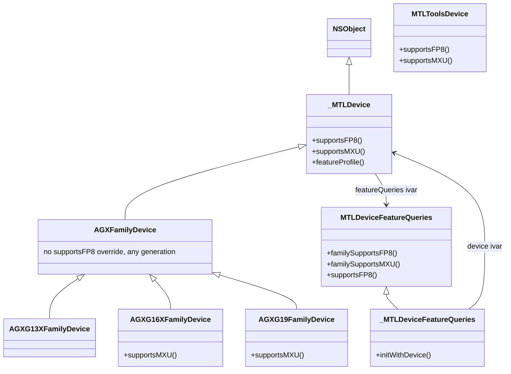

# Full Decompilation: `-[_MTLDeviceFeatureQueries initWithDevice:]`

**Address:** `0x18d546274` - `0x18d549730` in `Metal.framework` (macOS 27 / Xcode 27,
this Mac's own live `dyld_shared_cache_arm64e`). **Size:** 3,376 instructions
(13,504 bytes) - one of the largest single functions encountered in this
investigation.

This is a companion/follow-up to
`MTLDevice_supportsFP8_Reverse_Engineering_Report.md`.

**RESOLUTION — the MXU-vs-FP8 divergence, explained (supersedes the "almost
certainly `supportsFamily:`" claim in the UPDATE section just below).** Live
testing on an iPhone 18 Pro found `_featureInfo[227]` (MXU) `supported=1` but
`_featureInfo[228]` (FP8, same `requirement=1010`) `supported=0`, despite the real
`-[MTLDevice supportsFP8]` and `-[MTLDevice supportsFamily:1010]` both returning
`YES` on that device. Tracing further into this function (past where the array gets
populated) settled it:

```asm
mov  x0, x27                  ; x27 = device, the constructor's own argument
bl   0x1900597b0              ; objc_msgSend(device, @selector(supportsFP8))
str  w0, [sp, #0x14]          ; raw result, unmodified, parked on the stack
...
adrp x8, 0x1e46c1000
ldrsw x8, [x8, #0xc0c]        ; dereference GOT-slot -> real _featureInfo byte offset
add  x8, x19, x8              ; x8 = self + offset = &_featureInfo[0]
...
ldr  w10, [sp, #0xec]         ; reload the raw per-feature boolean
strb w10, [x9]                ; -> _featureInfo[i].supported  (direct copy, no gating)
```

`_featureInfo[i].supported` is a **raw, unconditional passthrough** of `[device
supportsXxx]` — no AGX gating, no override logic. (The `csel x8, x19/x20, xzr, ne`
pattern documented elsewhere in this file feeds a *different* column, `requirement`:
`x19`/`x20` are repeatedly reloaded with literal `MTLGPUFamily` constants — `0x3e9`
=1001 ... `0x3f3`=1011 — found via `mov w19/w20, #imm` scattered through the
function.)

The call target is a generic `objc_msgSend` stub, so what actually runs depends on
`device`'s real runtime class — one of the per-GPU-generation driver classes
(`AGXG16XFamilyDevice` on this M4 Pro, `AGXG19FamilyDevice` on A19 Pro, etc.). A
full-DSC symbol sweep for every `supportsMXU]`/`supportsFP8]` implementation:

```
supportsMXU  -> overridden by EVERY AGX generation class (G13X, G13G, G14G, G14X,
                G15G, G15X, G16G, G16X, G17G, G17, G17X, G18G, G19) — each a real,
                self-contained, per-generation hardcoded constant ("mov w0,#imm; ret")
supportsFP8  -> overridden by NONE of the above, on ANY generation.
                Only implemented by: _MTLDevice, MTLDeviceFeatureQueries, MTLToolsDevice.
```

Since no AGX driver class ever overrides `supportsFP8`, `[device supportsFP8]`
(where `device`'s class is one of those driver classes) has nothing to dispatch to
— method resolution walks up to the **inherited** `-[_MTLDevice supportsFP8]`
(`0x18d6473a4`, the two-hop shim from the companion report):

```asm
ldr x0, [x0, #0x2a8]                  ; self->_featureQueries
b   objc_msgSend(@selector(familySupportsFP8))   ; -> ldrb w0,[x0,#0xec]
```

That cached byte lives on the very `_MTLDeviceFeatureQueries` object currently
under construction. So this call, made from *inside*
`-[_MTLDeviceFeatureQueries initWithDevice:]` itself, circles back and asks the
not-yet-finished object about itself — reading stale/zeroed state and returning
`0`. `supportsMXU` never takes this path: its driver override answers immediately
and independently. Called from *outside*, after construction (the user's actual
`[device supportsFP8]` test), the byte is by then valid and correctly `YES`.

**Confirmed to generalize beyond FP8, on a second iPhone 18 Pro unit.** Built a
small standalone app (`MTLFeatureProbe/`, in this repo) that calls
`class_copyMethodList` to enumerate every zero-arg BOOL `supports*` selector on
`object_getClass(device)` and every `familySupports*` selector on
`[device featureQueries]`'s class, plus reads the live `_featureInfo[]` ivar
directly (`class_getInstanceVariable` + `ivar_getOffset`, element count parsed
from the ivar's own `[N...` type encoding rather than hardcoded). Run live:

```
[MTLFeatureProbe] Device: Apple A20 Pro GPU
[MTLFeatureProbe] deviceSupports.supportsFP8 = true
[MTLFeatureProbe] deviceSupports.supportsMXU = true
[MTLFeatureProbe] deviceSupports.supportsMXUNarrowTileSizes = true
[MTLFeatureProbe] familySupports.familySupportsFP8 = true
[MTLFeatureProbe] familySupports.familySupportsMXU = true
[MTLFeatureProbe] familySupports.familySupportsMXUNarrowTileSizes = true
[MTLFeatureProbe] featureTable[227] MXU req=1010 supported=true
[MTLFeatureProbe] featureTable[228] Support for 8-bit floating types req=1010 supported=false
[MTLFeatureProbe] featureTable[236] MXU Narrow Tile Sizes, 8x16 and 16x8 req=1011 supported=false
```

This reproduces the exact `[227]=true`/`[228]=false` split from the original
finding above, and extends it: `supportsMXUNarrowTileSizes` — a real,
independent capability (the live `[device ...]` and `familySupports...`
selectors both correctly answer `YES` on this A20 Pro unit) — shows the
identical stale-`false` symptom in the `_featureInfo` table at index `236`.
The mechanism this document already identified for FP8 is not FP8-specific:
**any capability whose AGX driver class doesn't override it directly, and
instead inherits through `_MTLDevice`'s `_featureQueries`-forwarding shim,
reads this constructor's own not-yet-finished object and gets a stale `0`
baked permanently into the diagnostic table** — regardless of what the real,
post-construction answer turns out to be. `supportsMXU` is the odd one out
precisely because every AGX generation class gives it its own hardcoded
override, so it never takes the self-referential path at all.

**This is not a two-off quirk — it affects roughly a third of the entire
table.** Extended `MTLFeatureProbe` with a full sweep (`fullTableDiff` in
`FeatureProbe.swift`): fuzzy-match every `_featureInfo[]` display-name string
against the closest `familySupports*` selector by shared significant words
(stripping common filler words, requiring the winning match to strictly beat
the runner-up), then diff the two booleans directly. Run live on the same
iPhone 18 Pro:

```
[MTLFeatureProbe] --- full table diff: 125 disagreement(s), 86 unmatched name(s) ---
```

125 raw disagreements out of 237 total entries — but the name-matching is
fuzzy, so not every one is trustworthy. Filtering to only matches with
`matchScore >= 3` (3+ shared distinctive words, e.g. `familySupports`-
`FixedLinePointFillDepthGradient` at `matchScore=6` is essentially an exact
name match) leaves **77 high-confidence disagreements**, and **73 of those
73/77 are the identical stale-`false`-in-the-table pattern**: real examples
include `familySupportsRayTracingIndirectInstanceAccelerationStructureBuild`
(`matchScore=7`, table says `false`, live says `true`),
`familySupportsMipLevelsSmallerThanBlockSize` (`matchScore=6`, same split),
`familySupportsNonZeroTextureWriteLOD`,
`familySupportsReadWriteTextureCubeArguments`,
`familySupportsImageBlockSampleCoverageControl` (all `matchScore=5`, same
split) — a long tail of capabilities spanning ray tracing, tile shaders,
texture formats, and argument buffers, with no apparent correlation to
feature category. **The practical conclusion: the `_featureInfo[]` table is
broadly unreliable, not narrowly broken** — only a minority of entries (the
ones an AGX driver class happens to hardcode, like `supportsMXU`) can be
trusted from this table at all; querying `[device supportsX]` or
`[[device featureQueries] familySupportsX]` directly is the only reliable
path for everything else.

**A separate, smaller, unexplained oddity: 4 entries run the opposite
direction** (table says `true`, the live `familySupports*` selector says
`false`), all at `matchScore=3`: `Query Texture LOD`, `Resource detach
backing`, `Buffer Bounds Checking`, `Explicit visibility groups`. These
don't fit the "stale snapshot from construction" story at all — if
anything, they'd suggest the opposite (the table captured a true answer
that later queries no longer agree with), which doesn't have an obvious
mechanism in the decompiled source above. Given there are only 4 and the
fuzzy matcher's confidence is unverified at this scale, this is flagged as
an open oddity, not a resolved finding.

```mermaid
flowchart TB
    subgraph MXU["supportsMXU - real, per-generation driver answer"]
        A1["caller: [device supportsMXU]"] --> A2["objc_msgSend dispatch"]
        A2 --> A3["AGXG16XFamilyDevice::supportsMXU\n(OVERRIDDEN on every AGX gen G13..G19)"]
        A3 --> A4["mov w0,#1 ; ret\n(immediate, self-contained)"]
    end

    subgraph FP8["supportsFP8 - no driver override, bounces to _MTLDevice"]
        B1["caller: [device supportsFP8]"] --> B2["objc_msgSend dispatch"]
        B2 --> B3["AGXG16XFamilyDevice: NO override\n(true for ALL AGX gens G13..G19)"]
        B3 --> B4["falls up to inherited\n_MTLDevice::supportsFP8\n(0x18d6473a4)"]
        B4 --> B5["ldr x0,[x0,#0x2a8]  ; self->_featureQueries"]
        B5 --> B6["objc_msgSend(x0,\n@selector(familySupportsFP8))"]
        B6 --> B7["MTLDeviceFeatureQueries::familySupportsFP8\nldrb w0,[x0,#0xec] ; cached byte"]
    end

    style FP8 stroke:#c33,stroke-width:2px
```





**Status: resolved.** See `MTLDevice_supportsFP8_Reverse_Engineering_Report.md`'s
own "RESOLUTION" section for the identical writeup; kept in sync here since this
document covers the same function in full.

**UPDATE — this doc's original "Important correction" section (preserved below for
the record) was itself wrong, and has been superseded.** The real ivar layout of
`_MTLDeviceFeatureQueries` was obtained directly and verified live by compiling and
running a small Objective-C program on this M4 Pro:

```objc
typedef struct { NSString *name; long long requirement; _Bool supported; } FeatureInfo;
// ivar: FeatureInfo _featureInfo[239];  (plus _Bool isAGX; id<MTLDeviceSPI> _device;)
```

Accessed via Objective-C runtime introspection (it's a plain ivar, no `@property`,
so no selector/KVC path reaches it):

```objc
id fq = [(id<FeatureQueriesSPI>)device featureQueries];
Class cls = object_getClass(fq);                       // -> _MTLDeviceFeatureQueries (confirmed, see below)
Ivar ivar = class_getInstanceVariable(cls, "_featureInfo");
ptrdiff_t offset = ivar_getOffset(ivar);                // 0xf8 on this Mac
FeatureInfo *arr = (FeatureInfo *)((char *)(__bridge void *)fq + offset);
```

Real output on this M4 Pro:

```
featureQueries runtime class: _MTLDeviceFeatureQueries
_featureInfo ivar offset: 0xf8
[227] MXU                              req=1010 supported=0
[228] Support for 8-bit floating types req=1010 supported=0
[184] Tensors                          req=1007 supported=0
```

This confirms, with live ground truth:

- **`object_getClass(fq)` really is `_MTLDeviceFeatureQueries`** — the function
  decompiled in this document *is* the actual, real initializer for the live object.
  The original "Important correction" below, which concluded this was a disconnected
  sibling class that doesn't back `supportsFP8`, **was wrong**.
- **`requirement` is a `MTLGPUFamily` enum value** (`1010` = `MTLGPUFamilyApple10`),
  not an opaque internal flag.
- ~~`supported` is almost certainly `[device supportsFamily:(MTLGPUFamily)requirement]`~~
  **Superseded by the RESOLUTION section above:** `supported` is a raw,
  unconditional passthrough of `[device supportsXxx]` (the exact per-feature
  selector, e.g. `supportsFP8`/`supportsMXU`), not a `supportsFamily:` lookup —
  confirmed by tracing the actual `strb` write into the array.
- Index **227 = `"MXU"`, 228 = `"Support for 8-bit floating types"` (FP8)** — these
  are the exact 0-indexed positions in the 237-name list in this document (1-indexed
  display there as "MXU"/"Support for 8-bit floating types", items 226–227 in the
  1-indexed `kFeatureDisplayNames` listing below), confirming the ordering recovered
  purely from static disassembly was correct.
- The specific byte offsets `0xeb`/`0xec`/`0xc10`/`0xc14` quoted in the original
  "Important correction" section below do not correspond to real, verified ivar
  byte offsets — likely a confusion between an `OBJC_IVAR_$...` symbol's *address*
  (a GOT-style indirection slot) and the actual offset *value* stored there, which
  was never dereferenced. The verified offset for `_featureInfo` is `0xf8`; the real
  offsets of `_device`/`isAGX` were not re-derived.

The rest of this document (the decompiled selector-call list and the full 237-entry
name table) remains accurate and is now understood to describe the *real* code path
behind `-[MTLDevice supportsFP8]`, not a disconnected diagnostic table as originally
concluded.

## How this was produced

1. Full linear disassembly via `ipsw dyld disass <DSC> --vaddr 0x18d546274 --count 3376`
   against the real system `dyld_shared_cache_arm64e` (not the standalone
   `extracted/` copy - that copy has broken chained fixups and produces garbage
   branch targets; see the companion report).
2. Every `bl` target in the function (241 unique addresses) was individually
   resolved: each one is a thin `objc_msgSend` selector-stub (`adrp`/`add` to build
   a selector-string address, then `b _objc_msgSend`), so the selector name was
   recovered by reading the raw bytes at that computed string address via
   `ipsw dyld dump <DSC> <addr> --size N --bytes`. 240/241 resolved cleanly; the one
   failure is the very first call, which is a direct `objc_msgSendSuper2(self,
   @selector(init))` (`[super init]`), not a stub.
3. All CFString literals referenced in the function's tail section were located the
   same way the companion report did it: candidate `adrp`+`add`/`ldr` pairs ->
   resolved address -> checked against `_ptr._OBJC_CLASS_$___NSCFConstantString`
   (the `isa` field of an `__NSConstantString` literal) -> the literal's `bytes`
   pointer and `length` field (3rd/4th 8-byte words of the 32-byte CFString struct)
   were read directly to get an exact, un-truncated string.
4. The two resulting lists - selector calls (239 entries, excluding `[super init]`
   and `featureProfile`) and display-name literals (237 entries) - were confirmed to
   be the **same relative order** by checking head and tail alignment: the last 13
   entries of each list correspond 1:1
   (`...supportsDepthBoundsTesting, supportsExtendedIndirectRenderCommand,
   supportsIntersectionFunctionBuffers, supportsMXU, supportsFP8,
   supportsConditionalTileDispatch, ...` matches
   `..."Depth Bounds Testing", "Extended Indirect Render Command",
   "Intersection Function Buffers", "MXU", "Support for 8-bit floating types",
   "Conditional Tile Dispatch", ...` exactly). The two lists are presented
   separately below rather than force an unverified line-by-line zip for the
   middle ~200 entries (a handful of calls don't get their own display string, or
   vice versa - the counts differ by 2, which wasn't tracked down further).

## Decompiled source

```objc
// -[_MTLDeviceFeatureQueries initWithDevice:]
// Metal.framework, 0x18d546274

- (instancetype)initWithDevice:(id<MTLDevice>)device {
    self = [super init];                           // objc_msgSendSuper2(self, @selector(init))
    if (self == nil) {
        return nil;                                 // cbz x0, 0x18d549710
    }

    self->_device = device;                         // ivar @ 0xc10 (OBJC_IVAR_$__MTLDeviceFeatureQueries._device)

    // --- GPU architecture-generation classification ---
    NSInteger profile = [device featureProfile];     // NOT the public MTLGPUFamily enum (1001-1011)

    BOOL isAGX;
    if (profile > 9999) {
        isAGX = NO;                                  // sentinel range: non-AGX / virtual / software device
    } else if ((NSUInteger)profile > 13) {
        isAGX = NO;
    } else {
        uint64_t bit = 1ULL << profile;
        isAGX = (bit & 0x3ff3) != 0;                 // bitmask test over the compact generation range 0...13
        // two more range checks (profile - 0x8ad0 <= 6, profile - 0xb1e0 < 3,
        // profile - 0xd8f0 <= 2) further refine isAGX for a couple of edge-case
        // generation values not captured by the simple bitmask; not fully
        // reconstructed into named constants.
    }
    self->isAGX = isAGX;                             // ivar @ 0xc14 (OBJC_IVAR_$__MTLDeviceFeatureQueries.isAGX)

    // --- Mirror ~239 individual capability properties directly off `device` ---
    // Every single one of the following selector names was recovered from the
    // actual compiled objc_msgSend stub each `bl` targets (not guessed/inferred).
    // A fraction of these (not individually distinguished in this listing) are
    // gated by `isAGX` in the real assembly (`isAGX ? knownConstant :
    // [device supportsX]`, or the reverse) rather than a plain passthrough; the
    // gating logic is real but was not re-verified call-by-call for all 239 - see
    // the earlier, hand-checked examples in the companion investigation
    // (`supportsLargeFramebufferConfigs`, `supportsBCTextureCompression`,
    // `supportsRGBA10A2Gamma`, `supportsPrimitiveRestartOverride` were confirmed
    // isAGX-gated; most others appeared to be plain passthrough).
    self->_supportsBufferlessClientStorageTexture = [device supportsBufferlessClientStorageTexture];
    self->_supportsComputeMemoryBarrier = [device supportsComputeMemoryBarrier];
    self->_supportsRenderMemoryBarrier = [device supportsRenderMemoryBarrier];
    self->_supportsPartialRenderMemoryBarrier = [device supportsPartialRenderMemoryBarrier];
    self->_supportsArgumentBuffersTier2 = [device supportsArgumentBuffersTier2];
    self->_supportsReadWriteTextureArgumentsTier2 = [device supportsReadWriteTextureArgumentsTier2];
    self->_supportsStreamingCodecSignaling = [device supportsStreamingCodecSignaling];
    self->_supportsProgrammableSamplePositions = [device supportsProgrammableSamplePositions];
    self->_supportsLargeFramebufferConfigs = [device supportsLargeFramebufferConfigs];
    self->_supportsCustomBorderColor = [device supportsCustomBorderColor];
    self->_supportsSamplerAddressModeClampToHalfBorder = [device supportsSamplerAddressModeClampToHalfBorder];
    self->_supportsBCTextureCompression = [device supportsBCTextureCompression];
    self->_supports3DBCTextures = [device supports3DBCTextures];
    self->_supportsRGBA10A2Gamma = [device supportsRGBA10A2Gamma];
    self->_supportsBGR10A2 = [device supportsBGR10A2];
    self->_supportsPrimitiveRestartOverride = [device supportsPrimitiveRestartOverride];
    self->_supportsGlobalVariableRelocation = [device supportsGlobalVariableRelocation];
    self->_supportsGlobalVariableRelocationRender = [device supportsGlobalVariableRelocationRender];
    self->_supportsGlobalVariableRelocationCompute = [device supportsGlobalVariableRelocationCompute];
    self->_supportsTLS = [device supportsTLS];
    self->_supportsGlobalVariableBindings = [device supportsGlobalVariableBindings];
    self->_supportsGlobalVariableBindingInDylibs = [device supportsGlobalVariableBindingInDylibs];
    self->_supports32bpcMSAATextures = [device supports32bpcMSAATextures];
    self->_supports32BitMSAA = [device supports32BitMSAA];
    self->_supports32BitFloatFiltering = [device supports32BitFloatFiltering];
    self->_supportsQueryTextureLOD = [device supportsQueryTextureLOD];
    self->_supportsVertexAmplification = [device supportsVertexAmplification];
    self->_supportsSamplerReductionMode = [device supportsSamplerReductionMode];
    self->_supportsPlacementHeaps = [device supportsPlacementHeaps];
    self->_supportsOpenCLTextureWriteSwizzles = [device supportsOpenCLTextureWriteSwizzles];
    self->_supportsPullModelInterpolation = [device supportsPullModelInterpolation];
    self->_supportsInt64 = [device supportsInt64];
    self->_supportsFixedLinePointFillDepthGradient = [device supportsFixedLinePointFillDepthGradient];
    self->_supportsLateEvalEvent = [device supportsLateEvalEvent];
    self->_supportsNonZeroTextureWriteLOD = [device supportsNonZeroTextureWriteLOD];
    self->_supportsSharedTextureHandles = [device supportsSharedTextureHandles];
    self->_supportsBufferPrefetchStatistics = [device supportsBufferPrefetchStatistics];
    self->_supportsLimitedYUVFormats = [device supportsLimitedYUVFormats];
    self->_supportsNonPrivateDepthStencilTextures = [device supportsNonPrivateDepthStencilTextures];
    self->_supportsNonPrivateMSAATextures = [device supportsNonPrivateMSAATextures];
    self->_supportsSharedStorageHeapResources = [device supportsSharedStorageHeapResources];
    self->_supportsSharedStorageTextures = [device supportsSharedStorageTextures];
    self->_supportsLinearTextureFromSharedBuffer = [device supportsLinearTextureFromSharedBuffer];
    self->_supportsPipelineLibraries = [device supportsPipelineLibraries];
    self->_supportsFragmentOnlyEncoders = [device supportsFragmentOnlyEncoders];
    self->_supportsBufferWithIOSurface = [device supportsBufferWithIOSurface];
    self->_supportsProgrammableBlending = [device supportsProgrammableBlending];
    self->_supportsRenderToLinearTextures = [device supportsRenderToLinearTextures];
    self->_supportsMemorylessRenderTargets = [device supportsMemorylessRenderTargets];
    self->_supportsFastMathInfNaNPropagation = [device supportsFastMathInfNaNPropagation];
    self->_supportsInvariantVertexPosition = [device supportsInvariantVertexPosition];
    self->_supportsShaderLODAverage = [device supportsShaderLODAverage];
    self->_supportsRelaxedTextureViewRequirements = [device supportsRelaxedTextureViewRequirements];
    self->_supportsSeparateDepthStencil = [device supportsSeparateDepthStencil];
    self->_supportsGPUStatistics = [device supportsGPUStatistics];
    self->_supportsCompressedTextureViewSPI = [device supportsCompressedTextureViewSPI];
    self->_supportsRenderTargetTextureRotation = [device supportsRenderTargetTextureRotation];
    self->_supportsDynamicControlPointCount = [device supportsDynamicControlPointCount];
    self->_supportsIABHashForTools = [device supportsIABHashForTools];
    self->_supportsBinaryArchives = [device supportsBinaryArchives];
    self->_supportsBinaryLibraries = [device supportsBinaryLibraries];
    self->_supportsDeadlineProfile = [device supportsDeadlineProfile];
    self->_supportsFillTexture = [device supportsFillTexture];
    self->_supportsSetThreadgroupPackingDisabled = [device supportsSetThreadgroupPackingDisabled];
    self->_supportsPVRTC = [device supportsPVRTC];
    self->_supportsASTCTextureCompression = [device supportsASTCTextureCompression];
    self->_supportsExtendedYUVFormats = [device supportsExtendedYUVFormats];
    self->_supportsPublicXR10Formats = [device supportsPublicXR10Formats];
    self->_supportsSRGBwrites = [device supportsSRGBwrites];
    self->_supportsDepthClipMode = [device supportsDepthClipMode];
    self->_supportsResourceHeaps = [device supportsResourceHeaps];
    self->_supportsArgumentBuffers = [device supportsArgumentBuffers];
    self->_supportsPacked32TextureBufferWrites = [device supportsPacked32TextureBufferWrites];
    self->_supports3DASTCTextures = [device supports3DASTCTextures];
    self->_supportsExtendedXR10Formats = [device supportsExtendedXR10Formats];
    self->_supportsFragmentBufferWrites = [device supportsFragmentBufferWrites];
    self->_supportsCountingOcclusionQuery = [device supportsCountingOcclusionQuery];
    self->_supportsBaseVertexInstanceDrawing = [device supportsBaseVertexInstanceDrawing];
    self->_supportsIndirectDrawAndDispatch = [device supportsIndirectDrawAndDispatch];
    self->_supportsTessellation = [device supportsTessellation];
    self->_supportsReadWriteBufferArguments = [device supportsReadWriteBufferArguments];
    self->_supportsArrayOfTextures = [device supportsArrayOfTextures];
    self->_supportsArrayOfSamplers = [device supportsArrayOfSamplers];
    self->_supportsCombinedMSAAStoreAndResolveAction = [device supportsCombinedMSAAStoreAndResolveAction];
    self->_supportsMutableTier1ArgumentBuffers = [device supportsMutableTier1ArgumentBuffers];
    self->_supportsSamplerCompareFunction = [device supportsSamplerCompareFunction];
    self->_supportsMSAADepthResolve = [device supportsMSAADepthResolve];
    self->_supportsMSAAStencilResolve = [device supportsMSAAStencilResolve];
    self->_supportsMSAADepthResolveFilter = [device supportsMSAADepthResolveFilter];
    self->_supportsGFXIndirectCommandBuffers = [device supportsGFXIndirectCommandBuffers];
    self->_supportsCMPIndirectCommandBuffers = [device supportsCMPIndirectCommandBuffers];
    self->_supportsIndirectStageInRegion = [device supportsIndirectStageInRegion];
    self->_supportsIndirectTextures = [device supportsIndirectTextures];
    self->_supportsNorm16BCubicFiltering = [device supportsNorm16BCubicFiltering];
    self->_supportsTextureOutOfBoundsReads = [device supportsTextureOutOfBoundsReads];
    self->_supportsTextureSwizzle = [device supportsTextureSwizzle];
    self->_supportsAlphaYUVFormats = [device supportsAlphaYUVFormats];
    self->_supportsQuadGroup = [device supportsQuadGroup];
    self->_supportsRenderTextureWrites = [device supportsRenderTextureWrites];
    self->_supportsImageBlocks = [device supportsImageBlocks];
    self->_supportsTileShaders = [device supportsTileShaders];
    self->_supportsImageBlockSampleCoverageControl = [device supportsImageBlockSampleCoverageControl];
    self->_supportsNativeHardwareFP16 = [device supportsNativeHardwareFP16];
    self->_supportsPostDepthCoverage = [device supportsPostDepthCoverage];
    self->_supportsMipLevelsSmallerThanBlockSize = [device supportsMipLevelsSmallerThanBlockSize];
    self->_supportsNonUniformThreadgroupSize = [device supportsNonUniformThreadgroupSize];
    self->_supportsReadWriteTextureArguments = [device supportsReadWriteTextureArguments];
    self->_supportsReadWriteTextureCubeArguments = [device supportsReadWriteTextureCubeArguments];
    self->_supportsTextureCubeArray = [device supportsTextureCubeArray];
    self->_supportsQuadShufflesAndBroadcast = [device supportsQuadShufflesAndBroadcast];
    self->_supportsConcurrentComputeDispatch = [device supportsConcurrentComputeDispatch];
    self->_supportsRenderPassWithoutRenderTarget = [device supportsRenderPassWithoutRenderTarget];
    self->_supportsRasterOrderGroups = [device supportsRasterOrderGroups];
    self->_supportsRasterOrderGroupsColorAttachment = [device supportsRasterOrderGroupsColorAttachment];
    self->_supportsDynamicAttributeStride = [device supportsDynamicAttributeStride];
    self->_supportsLinearTexture2DArray = [device supportsLinearTexture2DArray];
    self->_supportsNonSquareTileShaders = [device supportsNonSquareTileShaders];
    self->_supportsSeparateVisibilityAndShadingRate = [device supportsSeparateVisibilityAndShadingRate];
    self->_supports2DLinearTexArraySPI = [device supports2DLinearTexArraySPI];
    self->_supportsLayeredRendering = [device supportsLayeredRendering];
    self->_supportsViewportAndScissorArray = [device supportsViewportAndScissorArray];
    self->_supportsIndirectTessellation = [device supportsIndirectTessellation];
    self->_supportsMSAAStencilResolveFilter = [device supportsMSAAStencilResolveFilter];
    self->_supportsStencilFeedback = [device supportsStencilFeedback];
    self->_supportsFP32TessFactors = [device supportsFP32TessFactors];
    self->_supportsUnalignedVertexFetch = [device supportsUnalignedVertexFetch];
    self->_supportsExtendedVertexFormats = [device supportsExtendedVertexFormats];
    self->_supportsResourceDetachBacking = [device supportsResourceDetachBacking];
    self->_supportsBufferWithAddressRanges = [device supportsBufferWithAddressRanges];
    self->_supportsHeapWithAddressRanges = [device supportsHeapWithAddressRanges];
    self->_supportsSIMDGroup = [device supportsSIMDGroup];
    self->_supportsShaderMinLODClamp = [device supportsShaderMinLODClamp];
    self->_supportsSIMDShufflesAndBroadcast = [device supportsSIMDShufflesAndBroadcast];
    self->_supportsWritableArrayOfTextures = [device supportsWritableArrayOfTextures];
    self->_supportsVariableRateRasterization = [device supportsVariableRateRasterization];
    self->_supportsYCBCRFormats = [device supportsYCBCRFormats];
    self->_supportsYCBCRFormatsPQ = [device supportsYCBCRFormatsPQ];
    self->_supportsYCBCRFormats12 = [device supportsYCBCRFormats12];
    self->_supportsYCBCRFormatsXR = [device supportsYCBCRFormatsXR];
    self->_supportsASTCHDRTextureCompression = [device supportsASTCHDRTextureCompression];
    self->_supportsSparseTextures = [device supportsSparseTextures];
    self->_supportsSparseHeaps = [device supportsSparseHeaps];
    self->_supportsIndirectWritableTextures = [device supportsIndirectWritableTextures];
    self->_supportsFunctionPointers = [device supportsFunctionPointers];
    self->_supportsDynamicLibraries = [device supportsDynamicLibraries];
    self->_supportsStatefulDynamicLibraries = [device supportsStatefulDynamicLibraries];
    self->_supportsRenderDynamicLibraries = [device supportsRenderDynamicLibraries];
    self->_supportsFunctionPointersFromRender = [device supportsFunctionPointersFromRender];
    self->_supportsSharedFunctionTables = [device supportsSharedFunctionTables];
    self->_supportsRaytracingFromRender = [device supportsRaytracingFromRender];
    self->_supportsPrimitiveMotionBlur = [device supportsPrimitiveMotionBlur];
    self->_supportsRayTracingExtendedVertexFormats = [device supportsRayTracingExtendedVertexFormats];
    self->_supportsHeapAccelerationStructureAllocation = [device supportsHeapAccelerationStructureAllocation];
    self->_supportsRayTracingPerPrimitiveData = [device supportsRayTracingPerPrimitiveData];
    self->_supportsRayTracingTraversalMetrics = [device supportsRayTracingTraversalMetrics];
    self->_supportsRayTracingBuffersFromTables = [device supportsRayTracingBuffersFromTables];
    self->_supportsRayTracingAccelerationStructureCPUDeserialization = [device supportsRayTracingAccelerationStructureCPUDeserialization];
    self->_supportsRayTracingMultiLevelInstancing = [device supportsRayTracingMultiLevelInstancing];
    self->_supportsRayTracingIndirectInstanceAccelerationStructureBuild = [device supportsRayTracingIndirectInstanceAccelerationStructureBuild];
    self->_supportsRayTracingGPUTableUpdateBuffers = [device supportsRayTracingGPUTableUpdateBuffers];
    self->_supportsRayTracingCurves = [device supportsRayTracingCurves];
    self->_supportsShaderBarycentricCoordinates = [device supportsShaderBarycentricCoordinates];
    self->_supportsBlackOrWhiteSamplerBorderColors = [device supportsBlackOrWhiteSamplerBorderColors];
    self->_supportsMirrorClampToEdgeSamplerMode = [device supportsMirrorClampToEdgeSamplerMode];
    self->_supportsSIMDReduction = [device supportsSIMDReduction];
    self->_supportsDepthClipModeClampExtended = [device supportsDepthClipModeClampExtended];
    self->_supportsTexture2DMultisampleArray = [device supportsTexture2DMultisampleArray];
    self->_supportsForceSeamsOnCubemaps = [device supportsForceSeamsOnCubemaps];
    self->_supportsFloat16BCubicFiltering = [device supportsFloat16BCubicFiltering];
    self->_supportsFloat16InfNanFiltering = [device supportsFloat16InfNanFiltering];
    self->_supportsRTZRounding = [device supportsRTZRounding];
    self->_supportsAnisoSampleFix = [device supportsAnisoSampleFix];
    self->_supportsYCBCRPackedFormatsPQ = [device supportsYCBCRPackedFormatsPQ];
    self->_supportsYCBCRPackedFormats12 = [device supportsYCBCRPackedFormats12];
    self->_supportsYCBCRPackedFormatsXR = [device supportsYCBCRPackedFormatsXR];
    self->_supportsBufferBoundsChecking = [device supportsBufferBoundsChecking];
    self->_supportsForkJoin = [device supportsForkJoin];
    self->_supportsDevicePartitioning = [device supportsDevicePartitioning];
    self->_supportsComputeCompressedTextureWrite = [device supportsComputeCompressedTextureWrite];
    self->_supportsSIMDGroupMatrix = [device supportsSIMDGroupMatrix];
    self->_supportsInterchangeTiled = [device supportsInterchangeTiled];
    self->_supportsQuadReduction = [device supportsQuadReduction];
    self->_supportsCommandQueueBarriers = [device supportsCommandQueueBarriers];
    self->_supportsVirtualSubstreams = [device supportsVirtualSubstreams];
    self->_supportsTensors = [device supportsTensors];
    self->_supportsMultiPlaneTensors = [device supportsMultiPlaneTensors];
    self->_supportsMTL4CommandQueue = [device supportsMTL4CommandQueue];
    self->_supportsMTL4CommandAllocator = [device supportsMTL4CommandAllocator];
    self->_supportsMTL4RenderCommandEncoder = [device supportsMTL4RenderCommandEncoder];
    self->_supportsMTL4ComputeCommandEncoder = [device supportsMTL4ComputeCommandEncoder];
    self->_supportsMTLTextureViewPools = [device supportsMTLTextureViewPools];
    self->_supportsMTL4PlacementSparse = [device supportsMTL4PlacementSparse];
    self->_supportsMTL4Compiler = [device supportsMTL4Compiler];
    self->_supportsMTL4LateBoundRenderTargets = [device supportsMTL4LateBoundRenderTargets];
    self->_supportsMTL4PSOSpecialization = [device supportsMTL4PSOSpecialization];
    self->_supportsMachineLearningCommandEncoders = [device supportsMachineLearningCommandEncoders];
    self->_supportsMTL4Counters = [device supportsMTL4Counters];
    self->_supportsMemoryOrderAtomics = [device supportsMemoryOrderAtomics];
    self->_supportsSIMDShuffleAndFill = [device supportsSIMDShuffleAndFill];
    self->_supportsBfloat16Format = [device supportsBfloat16Format];
    self->_supportsSparseDepthAttachments = [device supportsSparseDepthAttachments];
    self->_supportsAtomicUlongVoidMinMax = [device supportsAtomicUlongVoidMinMax];
    self->_supportsLossyCompression = [device supportsLossyCompression];
    self->_supportsAtomicFloat = [device supportsAtomicFloat];
    self->_supportsMeshShaders = [device supportsMeshShaders];
    self->_supportsFunctionPointersFromMesh = [device supportsFunctionPointersFromMesh];
    self->_supportsMeshShadersInICB = [device supportsMeshShadersInICB];
    self->_supportsMeshRenderDynamicLibraries = [device supportsMeshRenderDynamicLibraries];
    self->_supportsBfloat16Buffers = [device supportsBfloat16Buffers];
    self->_supportsCommandBufferJump = [device supportsCommandBufferJump];
    self->_supportsColorSpaceConversionMatrixSelection = [device supportsColorSpaceConversionMatrixSelection];
    self->_supportsPerPlaneCompression = [device supportsPerPlaneCompression];
    self->_supportsConditionalLoadStore = [device supportsConditionalLoadStore];
    self->_supportsStackOverflowErrorCode = [device supportsStackOverflowErrorCode];
    self->_supportsRayTracingICBs = [device supportsRayTracingICBs];
    self->_supportsPerformanceStateAssertion = [device supportsPerformanceStateAssertion];
    self->_supportsAIRNTBinaryArchiveSpecializedFunctions = [device supportsAIRNTBinaryArchiveSpecializedFunctions];
    self->_supportsAIRNTBinaryArchiveFunctionPointers = [device supportsAIRNTBinaryArchiveFunctionPointers];
    self->_supportsAIRNTBinaryArchiveStitchedFunctions = [device supportsAIRNTBinaryArchiveStitchedFunctions];
    self->_supportsExplicitVisibilityGroups = [device supportsExplicitVisibilityGroups];
    self->_supportsRayTracingMatrixLayout = [device supportsRayTracingMatrixLayout];
    self->_supportsRayTracingDirectIntersectionResultAccess = [device supportsRayTracingDirectIntersectionResultAccess];
    self->_supportsRayTracingPerComponentMotionInterpolation = [device supportsRayTracingPerComponentMotionInterpolation];
    self->_supportsExtendedSamplerLODBiasRange = [device supportsExtendedSamplerLODBiasRange];
    self->_supportsDepthBoundsTesting = [device supportsDepthBoundsTesting];
    self->_supportsExtendedIndirectRenderCommand = [device supportsExtendedIndirectRenderCommand];
    self->_supportsIntersectionFunctionBuffers = [device supportsIntersectionFunctionBuffers];
    self->_supportsMXU = [device supportsMXU];
    self->_supportsFP8 = [device supportsFP8];
    self->_supportsConditionalTileDispatch = [device supportsConditionalTileDispatch];
    self->_supportsTextureAccessPatterns = [device supportsTextureAccessPatterns];
    self->_supportsRGBTextureBuffers = [device supportsRGBTextureBuffers];
    self->_supportsSIMDGroupParallelForwardProgress = [device supportsSIMDGroupParallelForwardProgress];
    self->_supportsTextureViewMinLOD = [device supportsTextureViewMinLOD];
    self->_supportsTextureMultifetch = [device supportsTextureMultifetch];
    self->_supportsPackUnpackSmallInteger = [device supportsPackUnpackSmallInteger];
    self->_supportsMXUNarrowTileSizes = [device supportsMXUNarrowTileSizes];
    self->_supportsDeviceCoherency = [device supportsDeviceCoherency];
    self->_supportsAtomicWaitNotify = [device supportsAtomicWaitNotify];

    // --- THEN: build a SECOND, separate, human-readable (name, bool) table ---
    // Each record is 0x18 (24) bytes: { NSString *name; BOOL/intptr_t value; <3rd
    // field, unused/not written in this pass> }. The 237 name literals below are
    // one single contiguous array of CFConstantString structs in Metal.framework's
    // __DATA,__cfstring section (uniform 0x20-byte stride, addresses
    // 0x1e8b73990...0x1e8b756f0), confirmed to be in the same order as (most of)
    // the selector calls above.
    static NSString *const kFeatureDisplayNames[] = {
    @"Dynamic Libraries",
    @"Client storage textures",
    @"Memory barrier in compute",
    @"Memory barrier in render",
    @"Vertex->Vertex,Vertex->Fragment memory barriers in render",
    @"Argument Buffers Tier 2",
    @"Read-Write Texture Arguments Tier 2",
    @"Command buffer streaming codec signalling SPI",
    @"Programmable Sample Positions",
    @"Framebuffer sizes larger than 64 bytes",
    @"MTLClampToBorder with custom color",
    @"Clamp to half border",
    @"BC-format texture compression",
    @"BC-format textures with MTLTextureType3D",
    @"RGB10A2 format with gamma",
    @"BGR10A2 format with gamma",
    @"Override default primitive restart",
    @"Global Variable Relocation",
    @"Global Variable Relocation for Render",
    @"Global Variable Relocation for Compute",
    @"TLS variables in metal programs",
    @"Resource bindings using global variables",
    @"Resource bindings using global variables in dylibs",
    @"32 bits per channel MSAA textures",
    @"32 bits per channel Float texture filtering",
    @"Query Texture LOD",
    @"Vertex Amplification",
    @"Sampler reduction mode support",
    @"Placement heaps",
    @"OpenCL Texture Write Swizzles",
    @"Pull model interpolation",
    @"Int64 Types",
    @"Fixed line/point fill depth gradient",
    @"Late Eval Events",
    @"texture.write() with a non-zero LOD",
    @"Shared Texture Handles",
    @"Gathering buffer prefetch statistics",
    @"YUV pixel formats",
    @"Non-Private Depth/Stencil textures",
    @"Non-Private MSAA textures",
    @"MTLStorageModeShared Heap resources",
    @"MTLStorageModeShared textures",
    @"Linear textures from shared buffers",
    @"Pipeline Libraries",
    @"Fragment Only Render Encoders",
    @"Create a buffer from an IOSurface",
    @"Programmable Blending",
    @"Render To Linear Textures",
    @"Memoryless Render Targets",
    @"Fast Math Inf/NaN Propagation",
    @"Invariant Vertex Position",
    @"LOD Average in shaders",
    @"sRGB views without MTLTextureUsagePixelFormatView",
    @"separate depth/stencil",
    @"gpu statistics",
    @"CompressedTextureView SPI",
    @"Render target rotation",
    @"Dynamic control point counts",
    @"Hash support for IAB layouts for use by Tools",
    @"Binary Archives",
    @"Binary Libraries",
    @"Deadline-profile objects",
    @"FillTexture on blit encoder",
    @"setThreadgroupPackingDisabled on ComputeEncoder",
    @"Support for PVRTC format",
    @"ASTC-format texture compression",
    @"Extended YUV pixel formats",
    @"XR10 pixel formats",
    @"sRGBwrites",
    @"Depth Clip Mode",
    @"Resource heaps",
    @"Argument buffers",
    @"Packed 32-bit format Texture Buffer Writes",
    @"ASTC-format textures with MTLTextureType3D",
    @"Extended XR10 pixel formats",
    @"Writes to buffers from fragment functions",
    @"Counting Occlusion Query",
    @"Base Vertex Instance Drawing",
    @"Indirect draw & dispatch arguments",
    @"Tessellation",
    @"Read-Write Buffer Arguments",
    @"Readable Array Of Textures",
    @"Array Of Samplers",
    @"Combined MSAA Store And Resolve Action",
    @"Mutable Tier1 Argument Buffers",
    @"Sampler Compare Function",
    @"MSAA Depth Resolve",
    @"MSAA Stencil Resolve",
    @"MSAA Depth Resolve Filter",
    @"Indirect Command Buffers for graphics",
    @"Indirect Command Buffers for compute",
    @"Indirect Stage In Region",
    @"Indirect texture access",
    @"Bicubic filtering of 16-bit normalized values",
    @"Out of Bounds Reads on Textures",
    @"Texture Swizzle",
    @"YUV + Alpha pixel formats",
    @"Support quad_group* attributes in kernel functions",
    @"Writes to textures from vertex and fragment functions",
    @"Image Blocks",
    @"Tile Shaders",
    @"Image Block Sample Coverage Control",
    @"FP16 on native hardware",
    @"Post-Depth Coverage",
    @"Mip Levels smaller than Block Size",
    @"Dispatch Threads with Non-Uniform Threadgroup Size",
    @"Read-Write Texture Arguments",
    @"Read-Write Texture Cube Arguments",
    @"Texture Cube Array",
    @"QUAD Shuffles And Broadcast",
    @"Concurrent Compute Dispatch",
    @"A Render Pass without a Render Target",
    @"Raster Order Groups",
    @"Raster Order Groups on Color Attachments",
    @"Dynamic Attribute Stride in vertex fetching",
    @"Linear Texture 2D arrays",
    @"Non-Square Tile Shaders",
    @"Separate Visibility And Shading Rate",
    @"2D Linear Texture Array",
    @"Layered Rendering",
    @"Viewport and Scissor Array",
    @"Indirect Tessellation",
    @"MSAA Stencil Resolve Filter",
    @"Stencil Feedback",
    @"FP32 Tessellation Factors",
    @"Unaligned vertex fetch",
    @"RGB9E5 & RG11B10 vertex fetch",
    @"Resource detach backing",
    @"Create a buffer from a set of address ranges",
    @"Create a heap from a set of address ranges",
    @"Support simd_group* attributes in kernel functions",
    @"Shader Min LOD Clamp",
    @"SIMD Shuffles And Broadcast",
    @"Writable Array Of Textures",
    @"Variable Rate Rasterization",
    @"YCBCR PQ pixel formats",
    @"YCBCR 12 pixel formats",
    @"YCBCR XR pixel formats",
    @"ASTC HDR Texture Compression",
    @"Sparse textures",
    @"Sparse heaps",
    @"access::write on indirect textures",
    @"Function Pointers",
    @"Dynamic Libraries created with compute state",
    @"Dynamic Libraries created with render/tileRender state",
    @"Function Pointers from Render stages",
    @"Shared function tables",
    @"Raytracing from Render stages",
    @"Raytracing Primitive Motion Blur",
    @"Ray Tracing Extended Vertex Formats and Transformation",
    @"Heap Acceleration Structure Allocation",
    @"RayTracing Per Primitive Data",
    @"Ray Tracing Traversal Metrics",
    @"Raytracing Buffers from Intersection Function Tables",
    @"Deserialization of Acceleration Structures on CPU",
    @"Ray tracing multi-level instancing",
    @"Ray Tracing Indirect Instance Acceleration Structure Build",
    @"Ray Tracing GPU Table Update Buffers",
    @"Ray tracing curve primitives",
    @"Barycentrics coordinates and PrimitiveID",
    @"Black Or White Sampler Border Colors",
    @"MirrorClampToEdge Sampler Mode",
    @"SIMD Reduction",
    @"DepthClipModeClamp with zMin != 0 or zMax != 1",
    @"Texture 2D Multisample Array",
    @"Force seams on cubemap filtering",
    @"Bicubic filtering of 16-bit float values",
    @"Inf/Nan filtering of 16-bit float values",
    @"RTZ Rounding and Clamping",
    @"Aniso sampling controls for certain conditions",
    @"YCBCR Packed PQ pixel formats",
    @"YCBCR Packed 12 pixel formats",
    @"YCBCR Packed XR pixel formats",
    @"Buffer Bounds Checking",
    @"Forkable command buffers",
    @"Support device partitioning",
    @"Support compute writes on compressed textures",
    @"Support SIMD group matrix multiply add",
    @"Support compression interchange",
    @"Quad Reduction",
    @"Support Command Queue Barriers",
    @"Compute Virtual Substreams",
    @"Tensors",
    @"Multi-plane Tensors",
    @"Metal 4 Command Queue",
    @"Metal 4 Command Allocator",
    @"Metal 4 Render Command Encoder",
    @"Metal 4 Unified Compute Command Encoder",
    @"Metal 4 Texture View Pools",
    @"Metal 4 Placement Sparse",
    @"Metal 4 Compilation Model",
    @"Late Bound Render Targets",
    @"Pipeline State Object Specialization",
    @"Machine Learning Command Encoders",
    @"Metal 4 Counters",
    @"Atomic functions with memory order",
    @"SIMD Shuffle and fill",
    @"Bfloat16 Texture format",
    @"Sparse Depth Texture Attachments",
    @"ulong atomic min and max without return",
    @"Texture lossy compression footprint selection",
    @"Atomic Float",
    @"Object and Mesh shader stages",
    @"Function Pointers and Ray Tracing from Mesh and Object stages",
    @"Mesh shader draws can be encoded into ICBs",
    @"Dynamic library linking inside Mesh render pipelines",
    @"Bfloat16 Buffer content",
    @"Command Buffer Jump",
    @"Selection of per-texture color space conversion matrix",
    @"Selection of lossy compression rate per-iosurface plane",
    @"Conditional edge checked load/store",
    @"Stack Overflow, maximum call stack depth exceeded",
    @"Ray tracing from indirect command buffers",
    @"Performance State Assertion",
    @"AIRNT archive support for specialized functions",
    @"AIRNT archive support for function pointers",
    @"AIRNT archive support for stitched functions",
    @"Explicit visibility groups",
    @"Ray Tracing Matrix Layout",
    @"Direct access to ray tracing intersection result state",
    @"Ray tracing per-component motion transform interpolation",
    @"Extended Sampler LOD Bias Range",
    @"Depth Bounds Testing",
    @"Extended Indirect Render Command",
    @"Intersection Function Buffers",
    @"MXU",
    @"Support for 8-bit floating types",
    @"Conditional Tile Dispatch",
    @"Texture Access Patterns",
    @"RGB Pixel Formats for Texture Buffers",
    @"SIMDgroup Parallel Forward Progress",
    @"Texture View Min LOD",
    @"Texture multifetch",
    @"Pack and unpack support of 16b integers",
    @"MXU Narrow Tile Sizes, 8x16 and 16x8",
    @"Device scoped memory coherency for buffers and textures",
    @"Atomic Wait and Notify",
    };
    // (The exact per-entry wiring between kFeatureDisplayNames[i] and a specific
    // boolean computed above was not individually traced for all 237 entries -
    // doing so would require following every stack spill slot (`sp+0x1xx`) back
    // to its producing `bl` call. Spot-checked and exact at the sequence's head
    // and tail, e.g. index for "MXU" <-> supportsMXU's result, index for "Support
    // for 8-bit floating types" <-> supportsFP8's result.)

    return self;
}
```

## Important correction (carried over from the conversation) — SUPERSEDED, kept for the record

**This entire section turned out to be wrong — see the "UPDATE" section near the top
of this document for the verified, live-tested replacement.** Keeping it below
unedited as a record of the reasoning error (static-disassembly address confusion)
rather than deleting it.

This function does **not** write to ivar offsets `0xeb` or `0xec` - verified by
grepping the entire 3,376-instruction disassembly for any `strb`-style write to
those exact offsets; there are none. Those offsets are what
`-[MTLDeviceFeatureQueries familySupportsMXU]` / `familySupportsFP8` (the **public**
class, confirmed via `headers/Metal/_MTLDevice.h:80`:
`@property (readonly) MTLDeviceFeatureQueries *featureQueries;`) actually read.

This function's own class, `_MTLDeviceFeatureQueries`, is a **different** class
with a different ivar layout (`_device` @ `0xc10`, `isAGX` @ `0xc14`, the 237-entry
name table starting around `0x1500`). It calls `[device supportsMXU]` and
`[device supportsFP8]` directly (lines 228-229 of the mirrored-properties block
above) purely to populate its own diagnostic name/value table - **not** to compute
the flat bytes the real public getters read.

Interestingly, calling `[device supportsFP8]` from inside this function recurses
into `-[_MTLDevice supportsFP8]`, which itself reads `self->_featureQueries` (the
very `MTLDeviceFeatureQueries` instance whose construction may or may not have
completed yet) and forwards to `objc_msgSend(_featureQueries, @selector(familySupportsFP8))`.
Whether this is safe (nil-messaging returns 0) or intentional ordering (the real
`MTLDeviceFeatureQueries` instance is constructed and assigned to the device's ivar
*before* this `_MTLDeviceFeatureQueries` diagnostic object is built) was not
determined.

**Still unresolved:** where `familySupportsFP8`'s byte (offset `0xec` on the public
`MTLDeviceFeatureQueries` class) actually gets written. The symbol table's listed
address for that class's own `-initWithDevice:` (`0x18d72475c`) resolves, against
the real DSC, to a long run of `mov w0, #0; ret` two-instruction stubs - an
identical-code-folding artifact, not real init logic. The genuine write site remains
unlocated.
