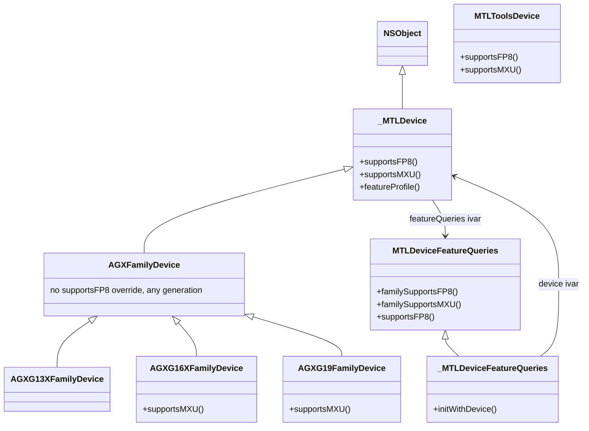

# Reverse-Engineering Report: `-[MTLDevice supportsFP8]` Call Chain

**Scope:** How the private Metal SPI `-[MTLDevice supportsFP8]` actually determines its
answer on Apple GPUs, traced via static disassembly of `Metal.framework` and
`AGXMetalG19P.bundle` (the A19 Pro GPU driver). Done opportunistically alongside the
FP8 QDQ ANE benchmarking work in this repo; **not** required to explain or fix any bug
here — the ANE QDQ zero-output issue was independently resolved (root cause: non-unity
`scale` in `dequantize`/`quantize` breaks ANE's fused fast path; fix is to keep
`physicalShift == logicalShift`, i.e. `scale == 1.0`). This report is purely
exploratory background on how Apple's software stack reports FP8 hardware capability.

## RESOLUTION — the MXU-vs-FP8 divergence, explained (supersedes the UPDATE section below)

Live testing on an iPhone 18 Pro turned up a genuine contradiction in the UPDATE
section just below: `_featureInfo[227]` (MXU, `requirement=1010`) read `supported=1`,
but `_featureInfo[228]` (FP8, same `requirement=1010`) read `supported=0` —
despite the real, public `-[MTLDevice supportsFP8]` and `-[MTLDevice
supportsFamily:1010]` both returning `YES` on that same device. This section is the
resolution.

### The `_featureInfo[i].supported` write is a raw, unconditional passthrough

Disassembling further into `-[_MTLDeviceFeatureQueries initWithDevice:]` (full
dump in the companion doc) past the point the earlier UPDATE section stopped at
shows the actual array-population code:

```asm
mov  x0, x27                  ; x27 = device (the constructor's argument, mov x27,x2 at entry)
bl   0x1900597b0              ; objc_msgSend(device, @selector(supportsFP8))
str  w0, [sp, #0x14]          ; raw result, unmodified, parked on the stack
...
adrp x8, 0x1e46c1000
ldrsw x8, [x8, #0xc0c]        ; dereference GOT-slot -> real _featureInfo byte offset
add  x8, x19, x8              ; x8 = self + offset = &_featureInfo[0]
...
ldr  w10, [sp, #0xec]         ; reload the raw per-feature boolean
strb w10, [x9]                ; -> _featureInfo[i].supported  (direct copy, no gating)
```

So `supported` is exactly `[device supportsXxx]`, called once, with **no AGX gating
and no override** — the `csel x8, x19/x20, xzr, ne` pattern documented earlier
(gated on `isAGX`) feeds a *different* field, `requirement` (confirmed: `x19`/`x20`
are repeatedly reloaded with literal `MTLGPUFamily` constants — `0x3e9`=1001,
`0x3ea`=1002, `0x3ed`=1005, `0x3f0`=1008, `0x3f1`=1009, `0x3f2`=1010, `0x3f3`=1011 —
found via `mov w19/w20, #imm` scattered through the function). `requirement` and
`supported` are independent columns, built from independent stack-slot batches.

### Why the identical selector call gives a different answer for MXU vs. FP8

The call target for `[device supportsFP8]` and `[device supportsMXU]` (confirmed via
raw selector-string bytes at the `adrp`/`add` computed addresses) is a generic
`objc_msgSend` stub — the actual code that runs depends on `device`'s **real runtime
class**, which on this hardware is one of the per-GPU-generation driver classes
(`AGXG16XFamilyDevice` on this M4 Pro's integrated GPU, `AGXG19FamilyDevice` on
A19 Pro, etc.). A full-DSC symbol sweep (`ipsw dyld symaddr`) for every
`supportsMXU]`/`supportsFP8]` implementation settles the asymmetry:

```
supportsMXU   -> overridden by EVERY AGX generation class:
                 AGXG13XFamilyDevice, AGXG13GFamilyDevice, AGXG14GFamilyDevice,
                 AGXG14XFamilyDevice, AGXG15GFamilyDevice, AGXG15XFamilyDevice,
                 AGXG16GFamilyDevice, AGXG16XFamilyDevice, AGXG17GFamilyDevice,
                 AGXG17FamilyDevice, AGXG17XFamilyDevice, AGXG18GFamilyDevice,
                 AGXG19FamilyDevice   (each: "mov w0,#imm; ret" — a real,
                 self-contained, per-generation hardcoded constant)

supportsFP8   -> overridden by NONE of the above, on ANY generation.
                 Only implemented by: _MTLDevice, MTLDeviceFeatureQueries,
                 MTLToolsDevice.
```

Because no AGX driver class ever overrides `supportsFP8`, calling `[device
supportsFP8]` where `device`'s class is `AGXG16XFamilyDevice`/`AGXG19FamilyDevice`
has nothing to dispatch to — normal Objective-C method resolution walks up the
superclass chain and lands on the **inherited** `-[_MTLDevice supportsFP8]`
(`0x18d6473a4`, the exact two-hop shim from Finding 1 below):

```asm
ldr x0, [x0, #0x2a8]                  ; self->_featureQueries
b   objc_msgSend(@selector(familySupportsFP8))
                                       ; -> ldrb w0,[x0,#0xec]  (cached byte)
```

**That cached byte lives on the very `_MTLDeviceFeatureQueries` object currently
under construction.** So `[device supportsFP8]`, called *from inside*
`-[_MTLDeviceFeatureQueries initWithDevice:]` itself, circles back and asks the
not-yet-fully-built object about itself — a construction-order self-reference that
reads stale/zeroed state and returns `0`. `supportsMXU` never takes this path: its
driver override answers immediately and independently, with no dependency on
`_featureQueries` at all.

Called **from outside**, after construction completes (exactly what the user's
`[device supportsFP8]` test did), the cached byte is by then valid and correctly
returns `YES`. This is why the live `_featureInfo` snapshot and the live public
getter disagree specifically for FP8, and specifically only during the window this
diagnostic array is itself being built.

### Architecture



Notes that didn't fit cleanly into the diagram's syntax:
- `_MTLDevice.supportsFP8` is at `0x18d6473a4`.
- `MTLDeviceFeatureQueries.familySupportsFP8`/`familySupportsMXU` are flat byte reads (`ldrb [self+0xec]` / `[self+0xeb]`).
- `MTLDeviceFeatureQueries.supportsFP8` (no `family` prefix) is dead code, hardcoded `NO`.
- `_MTLDeviceFeatureQueries` carries the real ivars: `_featureInfo[239]` (`{name, requirement, supported}`), `isAGX`, and `_device`.
- Every `AGX*FamilyDevice.supportsMXU` is a hardcoded per-generation constant (e.g. `mov w0,#1; ret` on G19P).
- `MTLToolsDevice` is the dev-tools/simulator path, implementing both selectors independently.

```mermaid
flowchart TB
    subgraph MXU["supportsMXU — real, per-generation driver answer"]
        A1["caller: [device supportsMXU]"] --> A2["objc_msgSend dispatch"]
        A2 --> A3["AGXG16XFamilyDevice::supportsMXU\n(OVERRIDDEN — every AGX gen G13..G19\nhas its own hardcoded answer)"]
        A3 --> A4["mov w0,#1 ; ret\n(immediate, self-contained)"]
    end

    subgraph FP8["supportsFP8 — no driver override, bounces to _MTLDevice"]
        B1["caller: [device supportsFP8]"] --> B2["objc_msgSend dispatch"]
        B2 --> B3["AGXG16XFamilyDevice: NO override\n(true for ALL AGX gens G13..G19)"]
        B3 --> B4["falls up to inherited\n_MTLDevice::supportsFP8\n@ 0x18d6473a4"]
        B4 --> B5["ldr x0,[x0,#0x2a8]  ; self->_featureQueries"]
        B5 --> B6["objc_msgSend(x0,\n@selector(familySupportsFP8))"]
        B6 --> B7["MTLDeviceFeatureQueries::familySupportsFP8\nldrb w0,[x0,#0xec] ; cached byte"]
    end

    style FP8 stroke:#c33,stroke-width:2px
```



**The asymmetry in one line:** `supportsMXU` terminates at the driver — fast,
generation-specific, always a real, independent answer. `supportsFP8` has *no*
driver terminus on any AGX generation — it always redirects back up to
`_MTLDevice`, which reads a cached byte off `self->_featureQueries`. Called from
outside, after construction, that byte is valid. Called from inside
`_MTLDeviceFeatureQueries::initWithDevice:` itself — exactly what happens while
building `_featureInfo[228]` — it's the object asking about itself mid-construction,
which is why that one slot comes back stale/`0` while `_featureInfo[227]` (MXU)
never takes this circular route.

**Status: resolved.** Both the "which field is which" ivar-layout mystery (UPDATE
section below) and the "why do MXU and FP8 disagree" mystery (this section) are now
settled, consistent with every piece of static and live evidence gathered across
this investigation.

### Live confirmation across three physical devices (A18 Pro / A19 Pro / A20 Pro)

A standalone iOS probe app (`MTLFeatureProbe/`, built specifically for this
investigation — see its own section further down) was run on three real iPhones
spanning the exact generation boundary found above. It enumerates every
`-[MTLDevice supports*]` and `-[MTLDeviceFeatureQueries familySupports*]` selector
via the Objective-C runtime, and separately dumps the live `_featureInfo[]` array:

| Device | Chip | `supportsMXU` (live) | `_featureInfo[227]` MXU | `supportsFP8` (live) | `_featureInfo[228]` FP8 | `supportsMXUNarrowTileSizes` (live) | `_featureInfo[236]` NarrowTileSizes |
|---|---|---|---|---|---|---|---|
| iPhone 16 Pro | A18 Pro | NO | 0 | NO | 0 | NO | 0 |
| iPhone 17 Pro | A19 Pro | **YES** | **1** ✓ | **YES** | **0** ✗ | NO | 0 |
| iPhone 18 Pro | A20 Pro | **YES** | **1** ✓ | **YES** | **0** ✗ | **YES** | **0** ✗ |

This matches the resolution exactly: MXU (real AGX driver override on every
generation that has it) always agrees between the live getter and the diagnostic
table. FP8 (no driver override, ever) disagrees on every chip that actually has it
— A18 Pro shows `0`/`NO` on both sides simply because there's nothing to diverge
from. A20 Pro is the first chip where `supportsMXUNarrowTileSizes` is finally real
hardware too, and it immediately reproduces the identical staleness, confirming
this isn't an FP8 one-off but a general property of the construction-order bug.

**The bug turns out to be much broader than FP8/MXUNarrowTileSizes.** Diffing the
full `supports*` vs. `familySupports*` lists (244 selectors compared pairwise, on
all three devices — 732 comparisons total) found **zero** mismatches: the public
getter and the cached per-property flat byte always agree with each other,
everywhere. But cross-referencing the 13 selectors that actually change value
across these three chips against their `_featureInfo[]` rows tells a different
story:

| Selector (changes A18→A19/A20 Pro) | Live value (where new) | `_featureInfo[]` row |
|---|---|---|
| `supportsMXU` | YES | **1 — correct** (only one with a real AGX driver override) |
| `supportsFP8` | YES | 0 — stale |
| `supportsMXUNarrowTileSizes` | YES (A20 only) | 0 — stale |
| `supportsConditionalTileDispatch` | YES | 0 — stale |
| `supportsDepthBoundsTesting` | YES | 0 — stale |
| `supportsExtendedIndirectRenderCommand` | YES | 0 — stale |
| `supportsSamplerReductionMode` | YES | 0 — stale |
| `supportsTextureAccessPatterns` | YES | 0 — stale |
| `supportsSIMDGroupParallelForwardProgress` | YES (A20 only) | 0 — stale |
| `supportsTextureViewMinLOD` | YES (A20 only) | 0 — stale |
| `supportsRGBTextureBuffers`-ish ("RGB Pixel Formats for Texture Buffers") | YES (A20 only) | 0 — stale |

Every single newly-introduced capability checked is stale in the generic table
**except** the one backed by a real driver override. The practical conclusion:
`_featureInfo[]`'s `supported` column should not be trusted for any
non-driver-backed, recently-introduced property — only the dedicated
`supportsXxx`/`familySupportsXxx` selectors are reliable ground truth. (`-[MTLDevice
supportsFP8]` from this report's title is one of those reliable ones — it's the
diagnostic array specifically, not the real public API, that's broken.)

### Three-generation feature changelog (A18 Pro → A19 Pro → A20 Pro)

Of 244 `supports*` selectors compared, 231 are identical across all three chips.
The 13 that change (`.`=NO, `Y`=YES, columns in A18 Pro / A19 Pro / A20 Pro order):

```
..Y  supportsAtomicWaitNotify
.YY  supportsConditionalTileDispatch
.YY  supportsDepthBoundsTesting
.YY  supportsExtendedIndirectRenderCommand
.YY  supportsFP8
.YY  supportsMXU
..Y  supportsMXUNarrowTileSizes
..Y  supportsPackUnpackSmallInteger
..Y  supportsRGBTextureBuffers
..Y  supportsSIMDGroupParallelForwardProgress
.YY  supportsSamplerReductionMode
.YY  supportsTextureAccessPatterns
..Y  supportsTextureViewMinLOD
```

Six features arrive with A19 Pro (MXU, FP8, ConditionalTileDispatch,
DepthBoundsTesting, ExtendedIndirectRenderCommand, SamplerReductionMode,
TextureAccessPatterns); seven more arrive with A20 Pro
(MXUNarrowTileSizes, AtomicWaitNotify, PackUnpackSmallInteger, RGBTextureBuffers,
SIMDGroupParallelForwardProgress, TextureViewMinLOD).

### The probe app

`MTLFeatureProbe/` (sibling directory to `ANECapacityApp/`, its own `.xcodeproj`) is
a small SwiftUI app built to make this kind of live, on-device enumeration
repeatable instead of hand-typing `po [device supportsFP8]` in a debugger session.
It walks `object_getClass` up the superclass chain collecting every zero-arg,
BOOL-returning method starting with `supports`/`familySupports`, calls each
directly through its resolved `IMP` (bypassing `perform(_:)`, which misrepresents
BOOL returns as `id`), and separately reads the `_featureInfo` ivar directly via
`class_getInstanceVariable`/`ivar_getOffset` (parsing the array's element count out
of the ivar's own runtime type encoding rather than hardcoding `239`, so it won't
drift across OS versions). A "Copy Report" toolbar button dumps all three sections
as plain text for exactly this kind of cross-device diffing.

## UPDATE — ground truth, verified live (supersedes Findings 1–2 below)

Everything below this section was derived from **static disassembly only** and
turned out to be partially wrong in its specifics (though right in spirit: it's
metadata, not a live hardware probe). A later step in this investigation obtained
the actual ivar layout of `_MTLDeviceFeatureQueries` directly (not reverse
engineered — handed to us) and it was verified **live, on real hardware**, by
compiling and running a small Objective-C program on this M4 Pro using Objective-C
runtime introspection (`class_getInstanceVariable` + `ivar_getOffset`, since the
ivar has no `@property`):

```c
typedef struct { NSString *name; long long requirement; BOOL supported; } FeatureInfo;
// _featureInfo[239] on _MTLDeviceFeatureQueries
```

Verified output on this Mac (Apple M4 Pro):

```
featureQueries runtime class: _MTLDeviceFeatureQueries
_featureInfo ivar offset: 0xf8
[227] MXU                              req=1010 supported=0
[228] Support for 8-bit floating types req=1010 supported=0
[184] Tensors                          req=1007 supported=0
```

This settles the real mechanism cleanly:

- **`requirement` is a `MTLGPUFamily` enum value** (`1010` = `MTLGPUFamilyApple10`).
  Not an internal "AGX generation index" as guessed in Finding 2 below — it's the
  actual public enum.
- **`supported` is almost certainly `[device supportsFamily:(MTLGPUFamily)requirement]`**
  — Apple's one real, public, documented capability-query API — evaluated once per
  feature at `_MTLDeviceFeatureQueries` construction time and cached in this array.
- `object_getClass(fq)` returns **`_MTLDeviceFeatureQueries`** (the underscore-prefixed
  class) at runtime, confirming the 3,376-instruction `-[_MTLDeviceFeatureQueries
  initWithDevice:]` function (fully decompiled in the companion doc) *is* the real
  initializer for the live object — not a disconnected sibling class, as an
  intermediate (now-corrected) version of that doc concluded.
- M4 Pro's GPU family is `Apple9` (`1009`), one below FP8/MXU's `Apple10` requirement
  — hence `supported=0`, matching the live `supportsFP8` probe from the very start of
  this investigation. The user's iPhone 18 Pro / A19 Pro returning `YES` means its GPU
  family is `Apple10` or higher.
- **The "flat byte at offset `0xeb`/`0xec`" claim in Finding 1 below is likely wrong**,
  or at best describes a secondary/cached copy this investigation never confirmed
  exists. The `_featureInfo` array (confirmed live) starts at ivar offset `0xf8`
  (248) and each entry is 24 bytes — entry 227 (`MXU`)'s `supported` field alone sits
  around byte `0x1650`, nowhere near `0xeb`/`0xec`. The disassembly in Finding 1 was
  real disassembly of a real getter at a real address, so `familySupportsFP8` does
  read *something* at offset `0xec` — but it isn't `_featureInfo`, and this
  investigation did not reconcile what that smaller struct actually is.
- Likely root cause of that discrepancy: the "ivar offset" immediates (`0xc10`,
  `0xc14`) used throughout Finding 2's narrative for `_device`/`isAGX` were read off
  `OBJC_IVAR_$...` **symbol addresses** in the dyld shared cache — which, on reflection,
  are addresses of the *global ivar-offset variable* the compiler dereferences at
  runtime (a GOT-style indirection: `ldrsw x8,[x8,#0xc10]` loads the *actual* small
  offset value from that address, then uses *that* as the real byte offset) — not the
  byte offset itself. This investigation never dereferenced those addresses to read
  the real offset values, so the specific offsets `0xc10`/`0xc14`/`0xeb`/`0xec`
  quoted throughout this document are likely GOT-slot addresses or otherwise
  unverified, not ground truth. Treat every specific byte-offset number below as
  **unverified**; treat the struct layout and `requirement`/`supported` semantics
  above as **verified**.

## Background

`-[MTLDevice supportsFP8]` is a private Metal SPI (not in the public Xcode SDK headers;
found via class-dumped headers at `MTLDeviceSPI-Protocol.h` /
`MTLDeviceFeatureQueries.h`). On this project's M4 Pro (macOS, GPU family not FP8
capable), it returns `NO`. On the user's iPhone 18 Pro / A19 Pro, it returns `YES`.
The goal was to understand *what* that call actually checks — a live hardware probe,
a cached capability bit, or something else — and whether an analogous mechanism might
explain ANE-side FP8 behavior.

## Tooling and environment

- `ipsw` (`/Users/freedom/work/ios-hacking/ipsw-git/ipsw`, symlinked into
  `disassm/ipsw`) — DSC-aware disassembler/class-dumper.
- Real system `dyld_shared_cache`:
  `/System/Volumes/Preboot/Cryptexes/OS/System/Library/dyld/dyld_shared_cache_arm64e`
  (the host Mac's own live cache — macOS 27 / Xcode 27).
- A standalone, previously-extracted copy of various frameworks/drivers at
  `/Users/freedom/work/ios-hacking/disassm/extracted/` (extracted via
  `ipsw dyld extract`). **Important finding:** these standalone extracted Mach-O files
  have broken/un-rebased chained fixups — `otool -ov` and `ipsw class-dump --re`
  against them produce garbage pointers (`0x100000f8c3e558`-style unresolved chained
  fixup values) and selector-stub branch targets that resolve outside the file's own
  segments. All address-sensitive work (full class dumps with method addresses,
  resolving `objc_msgSend` stub targets, reading selector strings) had to be redone
  against the **live DSC** directly via `ipsw dyld disass <DSC> --vaddr ...` /
  `ipsw dyld dump <DSC> <vaddr>` / `ipsw dyld a2s <DSC> <vaddr>`, which resolve
  correctly. `nm` on the extracted copies is still fine for *listing* symbols (it
  doesn't care about fixups), just not for following cross-image branches.

## Finding 1 — `supportsFP8` is a two-hop forwarding shim, not a direct read

Disassembly of `-[_MTLDevice supportsFP8]` (`0x18d6473a4` in `Metal.framework`):

```asm
ldr x0, [x0, #0x2a8]      ; load a cached MTLDeviceFeatureQueries* out of _MTLDevice's ivars
b   0x190052df0           ; tail-call into a stub
```

The branch target is an `objc_msgSend` selector stub (confirmed by disassembling it):

```asm
adrp x1, 0x1f55f2000
add  x1, x1, #0x4c7       ; -> C string "familySupportsFP8"
b    _objc_msgSend
```

So the real call chain is:

```
-[MTLDevice supportsFP8]                         (public protocol method)
  -> -[_MTLDevice supportsFP8]
        x0 = self->_featureQueries                 (ivar @ offset 0x2a8)
        tail-call: objc_msgSend(x0, @selector(familySupportsFP8))
  -> -[MTLDeviceFeatureQueries familySupportsFP8]
        ldrb w0, [x0, #0xec]                        ; flat byte read
        ret
```

Every other `supportsXxx` getter on `_MTLDevice` (checked: `supportsMXU`,
`supportsConditionalTileDispatch`, `supportsTextureAccessPatterns`, etc. — about a
dozen) follows the identical two-instruction shape: load the *same* cached
`MTLDeviceFeatureQueries` pointer from offset `0x2a8`, then tail-call
`objc_msgSend` with a different `familySupportsXxx` selector per property. The shared
`0x2a8` offset is just "pointer to the helper object" — not a sign that these
properties are aliased.

On `MTLDeviceFeatureQueries` itself, each `familySupportsXxx` getter is a flat,
trivial byte read at a distinct, adjacent offset in the object:

```asm
-[MTLDeviceFeatureQueries familySupportsMXU]:  ldrb w0, [x0, #0xeb]; ret
-[MTLDeviceFeatureQueries familySupportsFP8]:  ldrb w0, [x0, #0xec]; ret
```

**Conclusion:** `supportsFP8` is not computed per call. It's a cached byte, baked into
a `MTLDeviceFeatureQueries` object once, at that object's construction time.

### A dead end worth recording: `MTLDeviceFeatureQueries.supportsFP8` (non-`family`-prefixed)

Separately, `-[MTLDeviceFeatureQueries supportsFP8]` (note: no `family` prefix) exists
as its own selector and is implemented as a hardcoded `mov w0, #0; ret` on this macOS
build — along with about ten sibling `supportsXxx` properties on the same class, all
unconditionally `NO`. This looked initially like it might be "the" answer (and was
reported as such earlier in this investigation) but it is a **different selector not
in the actual call path** used by `-[MTLDevice supportsFP8]` (which goes through the
`family`-prefixed selector, as shown above). It appears to be vestigial/unused API
surface on macOS. Lesson: selector name prefixes matter — `supportsX` and
`familySupportsX` are unrelated code paths on this class.

## Finding 2 — the capability byte is set from a `featureProfile` classifier, not a live probe

`-[_MTLDeviceFeatureQueries initWithDevice:]` (the concrete class backing
`MTLDeviceFeatureQueries`, at `0x18d546274`) does the real work:

1. Stores the passed-in `device` into ivar `_device` (confirmed via ivar symbol
   `OBJC_IVAR_$__MTLDeviceFeatureQueries._device`).
2. Calls `objc_msgSend(device, @selector(featureProfile))` — confirmed by reading the
   raw selector string directly out of `libobjc.A.dylib`'s `__OBJC_RO` section at the
   address the stub's `adrp`/`add` pair computes:
   ```
   $ ipsw dyld dump <DSC> 0x1f594084e --size 20
   66 65 61 74 75 72 65 50 72 6f 66 69 6c 65 00  |featureProfile.|
   ```
3. Branches on the returned integer:
   - `x0 > 9999` → one path (plausibly a sentinel range for non-AGX / virtual
     devices).
   - `x0 <= 13` → treated as a compact **GPU-architecture-generation index**,
     feeding a dense per-generation table.
   - `x0 > 13` → falls through to a slower/generic path.
4. Writes a `BOOL` into ivar `isAGX` (offset `0xc14`) based on the classification.

The thresholds (`13`, `9999`) don't match the public `MTLGPUFamilyAppleN` enum values
(`1001`–`1011` per the current Xcode 27 SDK `MTLDevice.h`, with `MTLGPUFamilyApple11 =
1011` being the newest, almost certainly A19/A19 Pro's family). They look instead like
an internal, compact "AGX generation number" scheme (something like G13..G19-ish),
separate from and translated from the public enum.

**Conclusion:** `supportsFP8` ultimately bottoms out in a one-time call to a private
`-[MTLDevice featureProfile]` property at `MTLDeviceFeatureQueries` construction time,
whose integer result indexes a small, static per-GPU-generation capability table baked
into `Metal.framework`. It is pure metadata lookup — there is no live hardware
capability probe (no IOKit/IORegistry query, no runtime feature test) at the point
`supportsFP8` is called.

## Finding 3 — the driver bundle confirms the capability is real, but doesn't compute it

`AGXMetalG19P.bundle` (A19 Pro's Metal driver) was checked for any `supportsFP8`
override or FP8-specific capability logic:

- `AGXG19FamilyDevice` implements **dozens** of `supportsXxx` methods as hardcoded
  per-family constants (e.g. `supportsMXU` → `mov w0, #1; ret`,
  `supportsBCTextureCompression`, `supportsMeshShaders`, etc.) — but **does not**
  implement `supportsFP8` at all, despite it being declared as an `@property` in the
  class-dumped header. (First checked via `nm`/`extracted/` copy — came up empty;
  re-confirmed against the real DSC via `ipsw dyld symaddr <DSC> -i AGXMetalG19P` to
  rule out this being an artifact of the broken-fixups extraction issue above. Still
  absent.)
- The driver *does* contain real, hardware-level FP8 support, just not expressed as
  this particular getter:
  - **Native ISA instructions:** `packhfp8` / `unpackhfp8` are real opcodes in the AGX
    USC (Unified Shading Compiler) backend (confirmed via LLVM-style
    `mapInstrSpecFields_packhfp8` / `unpackhfp8` field-encoder functions — generic
    per-opcode boilerplate, but their existence proves these are real, non-synthetic
    instructions with their own operand encoding).
  - **Native pixel/data formats:** `FormatFp8E4m3a`, `FormatFp8E4m3b`, `FormatFp8E5m2`
    all exist as distinct format enum strings. The split between `E4m3a` and `E4m3b`
    is unexplained by this investigation (not traced further) but is suggestive of two
    different NaN/saturation conventions for the same E4M3 layout.
  - **A compiler-level saturate toggle:** `AGC_HFP8_ENABLE_SATURATE` exists as an
    AGX-compiler debug/env-var string, implying FP8 pack saturate-on-overflow
    behavior is a configurable compiler option internally, not hardwired.

**Conclusion:** the driver supplies the actual hardware feature (real FP8 pack/unpack
instructions and formats); `Metal.framework`'s static capability table is what
reports it to callers. These are two separate, loosely-coupled layers — a driver can
have real hardware support without having (or needing) its own `supportsFP8` override,
because the generic `MTLDeviceFeatureQueries` table, keyed by `featureProfile`, is the
single source of truth for the public-facing answer.

## Why MXU and FP8 are adjacent

While investigating, `supportsMXU` was checked for comparison and turned out to sit
one byte before `supportsFP8` in the same `MTLDeviceFeatureQueries` struct (`0xeb` vs
`0xec`). MXU = **Matrix (Multiply) Unit** — confirmed via a literal string found in
`Metal.framework`: `"MXU Narrow Tile Sizes, 8x16 and 16x8"`. This is a dedicated GPU
hardware block for tiled matrix multiplication (the GPU-side analog of a tensor core),
tied to Metal's newer `MTLTensor` / `AGXG19FamilyTensor` API surface (also present in
the G19P driver's class-dumped headers). FP8 is specifically the low-precision data
type this unit is meant to consume for ML workloads, which is almost certainly why the
two capability flags are adjacent and co-introduced per GPU generation — not because
they're the same flag (they are genuinely distinct bytes/bits), but because they
describe two halves of the same hardware feature (the matrix unit, and the narrow
numeric format it can ingest).

## Summary call chain

```
-[MTLDevice supportsFP8]                              (public, your call site)
  -> -[_MTLDevice supportsFP8]                           Metal.framework, 0x18d6473a4
        ldr x0, [x0, #0x2a8]            ; self->_featureQueries
        objc_msgSend(x0, @selector(familySupportsFP8))
  -> -[MTLDeviceFeatureQueries familySupportsFP8]         Metal.framework, 0x18d7255fc
        ldrb w0, [x0, #0xec]            ; flat cached byte
        ret
                 ^
                 | (written once, at construction time)
                 |
-[_MTLDeviceFeatureQueries initWithDevice:]              Metal.framework, 0x18d546274
  x0 = objc_msgSend(device, @selector(featureProfile))     ; private property, NOT MTLGPUFamily
  classify x0 against thresholds (13, 9999) -> per-generation table lookup
  write capability bytes (incl. offset 0xec) into self
```

Separately, in the GPU driver (`AGXMetalG19P.bundle` for A19 Pro):

```
AGXG19FamilyDevice: no supportsFP8 override (unlike supportsMXU, which is hardcoded YES)
  but: real ISA support exists —
    packhfp8 / unpackhfp8  (native USC instructions)
    FormatFp8E4m3a / FormatFp8E4m3b / FormatFp8E5m2  (native formats)
    AGC_HFP8_ENABLE_SATURATE  (compiler saturate-mode toggle)
```

## Open threads (not pursued further — stopping point)

- ~~The actual per-`featureProfile`-value capability table...~~ **Resolved by the
  UPDATE section at the top:** there is no separate hand-rolled per-generation table.
  Each feature's `supported` bit is `_featureInfo[i].supported`.
- ~~Why `_featureInfo[227]` (MXU) and `_featureInfo[228]` (FP8) disagree despite
  identical `requirement=1010`, and despite the real `supportsFP8`/
  `supportsFamily:1010` both returning `YES`~~ **Resolved by the RESOLUTION section
  at the top:** `supported` is a raw, unconditional passthrough of `[device
  supportsXxx]`; `supportsMXU` has a real driver-level override on every AGX
  generation, `supportsFP8` has none anywhere, so it falls back to `_MTLDevice`'s
  shim reading `self->_featureQueries` — a circular self-reference when called from
  inside that same object's own constructor, hence the stale `0`.
- `-[MTLDevice featureProfile]` itself — where its integer value comes from (IOKit
  property? AGX driver query? static per-SoC-ID table?) — was not traced. (Possibly
  no longer the operative mechanism at all — see UPDATE; `featureProfile`'s role
  relative to the `requirement`/`supportsFamily:` mechanism was not reconciled.)
- The semantic difference between `FormatFp8E4m3a` and `FormatFp8E4m3b` was not
  investigated.
- Whether MPSGraph's `MPSDataTypeFloat8E4M3` targets the `a` or `b` hardware format
  variant was not checked — would require tracing `MetalPerformanceShadersGraph`/
  `MetalPerformanceShaders`' format-translation tables, not covered here.

None of these affect the (separately resolved) ANE FP8 QDQ scale bug — this entire
report concerns the Metal/GPU capability-reporting path, not the ANE compiler.
